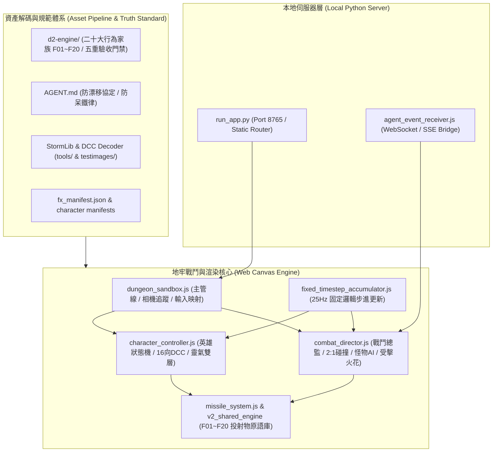

# 《暗黑破壞神2：毀滅之王》AI Agent 實時監控看板與戰鬥地牢專案
## 系統架構解析、代碼導引與核心技術痛點評審報告 (System Architecture & Pain Points)

> **給外部 AI 架構師與評審專家的指引 (Note for External AI Reviewers)**：  
> 本文檔專為第三方 AI 模型（如 Claude 3.7 Sonnet、GPT-4o、o3-mini 等）與資深圖形/逆向工程專家設計。  
> 閱讀本倉庫時，請重點審視本專案在**暴雪原版 MPQ DCC/COF 2.5D 資產還原**、**Canvas 等軸測渲染管線**、**多圖層骨架裝配**與**五大核心技術痛點**上的架構設計，並針對文末提出的聚焦問題提供具體的工程優化建議。

---

## 一、 專案願景、起源與核心目標 (Project Vision & Core Objectives)

### 1.1 專案背景
在現代 AI 輔助軟體開發過程中，CLI 終端機往往充斥著枯燥單調的文字日誌、Token 消耗統計與進度條。本專案將終端開發代理人（AI Coding Agent）的真實活動、Token 吞吐量與心跳狀態，視覺化映射至 1999~2001 年暴雪經典傳奇名作**《暗黑破壞神2：毀滅之王》(Diablo II: Lord of Destruction) 1.13c** 的遊戲畫面中。

### 1.2 核心使命與不可妥協之原則 (Non-negotiable Principles)
1. **100% Blizzard 暴雪原版 MPQ DCC/COF 二進位資產還原**：
   - 堅決反對任何 AI 生成的「假暗黑圖元」、手繪向量幾何佔位或低清重繪偽影。
   - 所有英雄、怪物、投射物、受擊特效與地表靈氣，皆直接萃取自暴雪原版 `d2data.mpq`、`d2char.mpq` 與 `d2exp.mpq`，經解碼還原而成。
2. **True Isometric 2.5D (45度等軸測 2:1 投影)**：
   - 嚴格遵守暗黑 2 經典菱形座標系（水平 X 與垂直 Y 呈 2:1 投影，螢幕角度 $\phi = \operatorname{atan2}(2 \cdot \Delta y, \Delta x)$）。
3. **沉浸式哥德體驗雙模式**：
   - **營火修整大廳 (Campfire Rest Mode)**：呈現七大經典職業圍繞營火待命，映射 Agent 處於低耗能 Idle 或對話狀態。
   - **等軸測戰鬥地牢 (Combat Dungeon Mode)**：包含 1~5 幕經典場景（修道院兵營、塔拉夏古墓、崔凡克神殿、混沌避難所、毀滅王座），Agent 執行工具或處理長任務時，化身出征英雄與地牢怪物激戰，Token 消耗轉化為技能狂飆與怪物擊殺。

---

## 二、 總體系統架構與代碼地圖 (Architecture & Key Codebase Index)

### 2.1 系統架構圖 (Mermaid Architecture Diagram)



### 2.2 核心檔案職責矩陣

| 核心檔案路徑 | 職責與關鍵技術點 | 核心類別 / 函式 |
| :--- | :--- | :--- |
| [character_controller.js](file:///Diablo2-Agent-Monitor/web/js/character_controller.js) | 英雄全狀態機（待命/走/跑/攻/施法/神盾/衝鋒/受擊）、16 方向離散朝向計算、裝甲熱切換（輕/中/重）、手盾一體圖集置換、雙層地表靈氣旋轉渲染、施法脫手幀（ReleaseFrame）校準、近戰自動逼近機制。 | `CharacterController` |
| [combat_director.js](file:///Diablo2-Agent-Monitor/web/js/combat_director.js) | 2.5D 等軸測戰鬥裁決中心：怪群波次生成、Boss 招式循環、2:1 橢圓碰撞檢測、受擊硬直、傷害跳字、ShockHitSm 受擊火花定心發射、暗黑地牢怪物尋路與分離演算法。 | `CombatDirector` |
| [dungeon_sandbox.js](file:///Diablo2-Agent-Monitor/web/js/dungeon_sandbox.js) | 地牢頂層主管線：主畫布 Canvas 渲染循環、相機平滑追蹤、Act 1~5 地牢瓦片動態加載、全域鍵盤快捷鍵映射（1~7, E, Z, Q, T, WASD, G, B, M, D, S）。 | `DungeonSandbox` |
| [combat_skills_ext.js](file:///Diablo2-Agent-Monitor/web/js/combat_skills_ext.js) | 七大職業技能擴充處理器：覆蓋重擊、衝鋒、神盾、連鎖電弧、落雷爆散、九頭海蛇、冰霜新星等各職業招式之生成調度。 | `directorProto.handleExtendedHeroSkill` |
| [fixed_timestep_accumulator.js](file:///Diablo2-Agent-Monitor/web/js/fixed_timestep_accumulator.js) | 嚴格對齊暴雪 D2 經典 25Hz（40ms/tick）邏輯步進更新器，徹底根除不同顯示器刷新率（60Hz/144Hz）或無頭環境降頻引發的位移動態失真。 | `FixedTimestepAccumulator` |
| [missile_system.js](file:///Diablo2-Agent-Monitor/web/js/missile_system.js) | 投射物物理管線：負責直線飛彈、穿透彈道（Pierce）、拋物線炸彈與延遲地表危害管理。 | `MissileSystem` |
| [v2_shared_engine/](file:///Diablo2-Agent-Monitor/web/v2_shared_engine/) | 工業級通用技能樣板庫：包含 F06 環形新星 (`radial_nova_template.ts`)、F09 連鎖電弧 (`chained_arc_template.ts`)、F07 散彈爆散與 F01 直線彈道等標準原語。 | `UniversalRuntimePlayer` |
| [d2-engine/](file:///d2-engine/) | 專案唯一最高真理庫：定義 11 大防呆鐵律、20 大行為家族 (F01~F20)、MPQ 數據表映射字典 (Skills.txt / Missiles.txt / Overlay.txt) 與五重真理驗收門禁。 | `d2-engine/SKILL.md` |
| [AGENT.md](file:///AGENT.md) | 主代理人執行協定：確立 d2-engine 最高真理單向覆蓋原則、零手繪向量禁令、防漂移約束與自動化測試驗收規範。 | `AGENT.md` |

---

## 三、 目前已攻克的重大里程碑 (Achieved Milestones)

### 3.1 魔法使（Sorceress）冰/火/電三系 16 大招式全量實裝
- **火焰系 (Fire)**：
  - 火彈 (Fire Bolt)、火球 (Fireball)：等軸測 16 方向貼圖映射與命中範圍爆裂。
  - 地獄火 (Inferno)：長按引導持續噴射狀態機，英雄手部鎖定釋放幀 (Frame 8) 靈敏轉向，0 抽搐。
  - 火牆 (Fire Wall) 與隕石 (Meteor)：17 幀原廠預警符文圈閃爍、天降落火爆震與 3.6 秒地表殘火燃燒。
  - 九頭海蛇 (Hydra)：依 `Overlay.txt` 實裝雙層立體火光包覆（PreDraw: 0 身前竄升烈焰 + 身後火光），8 向嘴吻精確咬合噴吐火彈。
- **冰霜系 (Cold)**：
  - 冰霜新星 (Frost Nova)：Elliptical LUT 8px 等弧長取樣，雙層微位移加法熔接，徹底消除菱形突起與頂底黑隙。
  - 冰風暴 (Ice Blast) 與冰川之刺 (Glacial Spike)：命中碎冰爆炸與怪物全身深藍冰凍減速。
  - 暴風雪 (Blizzard)：高空天頂斜向急墜尖銳冰柱與重型冰雹陣。
- **閃電系 (Lightning)**：
  - 電系新星 (Nova)：64 顆高密度電弧均勻徑向擴散，純白熾熱實心電環。
  - 連鎖閃電 (Chain Lightning)：以 14px 密集步長熔接為 18~22px 實心高壓等離子芯，端點頂點吸附（Vertex Snapping）連續貫穿多個目標。
  - 雷暴 (Thunder Storm)：英雄腳底常駐旋轉電環 (PreDraw: 1) 與週期天雷轟頂。

### 3.2 聖騎士（Paladin）完全體新舊合璧技能庫
- **作戰打擊招式 (Attacks)**：
  - 重擊 (Smite)：身前 90px 等軸測判定、暴雪原廠 S1 盾擊動作、必中昏眩、ShockHitSm 花火與 35px 擊退。
  - 衝鋒 (Charge)：2.4 倍極速突進貫穿敵陣，命中爆發 75 點重擊傷害並強效擊退 45px。
  - 熱誠五連斬 (Zeal)：以 **48 FPS（2倍攻速）** 驅動 15 幀動作圖集，單刀揮砍縮短至 312ms，5 刀 1.56 秒傾瀉完畢；受擊延遲縮減至 50ms 達成瞬發打擊反饋。
- **施法與投射物 (Casts)**：
  - 手盾一體金色神盾 (Holy Shield)：徹底根治外掛 2D 盾牌脫手飛走病灶，採用原廠圖集無縫置換，手在哪盾在哪，盾面原廠 Gleam.png 星芒持續流動。
  - 祝聖之槌 (Blessed Hammer)：阿基米德螺旋線方程式擴散，金色真槌 16 方向旋轉與半透明殘影拖尾。
  - 天堂之拳 (Fist of the Heavens)：天降神聖落雷直劈木人，受創點瞬發 6 發聖光散彈呈 360 度扇形貫穿。
  - 聖光彈 (Holy Bolt)：F01 直線彈道穿透機制，參考天堂之拳座標機制傳遞怪物接地座標，受擊花火精準定心於怪物胸膛。
- **正統 10 大雙層地表靈氣全數解鎖**：
  - 神聖之火、神聖冰凍、神聖衝擊（260px 全屏落雷劈擊）、狂熱、專注、力量、庇護所、審判（解碼原廠 21 幀 DCC 動畫）、荊棘、精準祝福。
- **近戰超距自動逼近 (Melee Auto-Approach)**：
  - 當玩家點選目標距離大於近戰射程（85px）時，角色自動切換奔跑朝目標身前尋路接近，進入範圍後自動剎車轉向並出招打擊。

---

## 四、 目前為止核心技術痛點與瓶頸 (Core Technical Pain Points)

在此誠摯邀請外部 AI 與專家深入審查以下五大瓶頸，並提供具體解法：

### 痛點一：技能動畫「原廠真理（Ground Truth）」的驗證與量化校準瓶頸
1. **問題現象**：
   - 暗黑破壞神 2 許多精確視覺參數（例如投射物生成幀數、加速度曲率、`pCltDoFunc` 子循環次數、碰撞包圍球 `PixHeight`、加法去黑閥值）深埋於 `D2Client.dll` 與 `D2Common.dll` 反組譯代碼中。
   - 雖然本專案透過 `official_visual_standards/` 本地歸檔了暴雪官方 Arreat Summit 與凱恩之角實機大圖，但官方截圖極為有限（許多技能僅有 1~2 張靜態圖），缺少全 16 方向、全動態影格的 Ground Truth。
2. **困境**：
   - 無法確切確認組合出的視覺效果是否與原版「100% 像素級一致」，例如：連鎖閃電的微抖動振幅究竟是 1.5px 還是 3px？冰霜新星在擴散到極限半徑時是否有漸進透明度衰減？
   - 目前使用的自動化量化評分腳本（如以最大連通域、色譜直方圖與長短軸比對），在缺乏足夠母圖的情況下容易遇到基準偏差。

### 痛點二：營火大廳選角動畫（Campfire Character Selection）的完整重現機制
1. **問題現象**：
   - 營火大廳選角畫面在暗黑 2 中並非單一背景圖加角色 GIF，而是一套專屬的動態交互系統：
     - **三階段狀態機**：
       1. 待命態（Unselected Idle）：角色坐於木樁、倚靠石柱或低頭磨刀。
       2. 選擇過渡態（Select Sequence）：玩家滑鼠點擊該角色時，觸發專屬的「站起身子、邁步走向螢幕前方、拔出武器擺出招牌姿勢」之連續動畫。
       3. 選中就緒態（Selected Loop）：英雄站在螢幕近端，保持高頻呼吸與待命循環。
     - **環境光影渲染**：中央營火的光源會隨火焰燃燒跳動，對七大職業的身體產生動態局部法線照亮（Radial Flickering Light Map）。
2. **困境**：
   - 如何從原版 MPQ（`CHARS/CAMPFIRE/...`）中完整抽取七大職業的三階段 DCC 與對應的 COF 幀數觸發點？
   - 瀏覽器 Canvas 在缺少原生 3D 法線貼圖的情況下，如何高保真重現營火動態光暈在角色衣服與金屬鎧甲上的閃爍反射？

### 痛點三：多圖層 COF 骨架即時裝配 vs 精靈圖資產爆炸（COF Layer Assembly vs Asset Explosion）
1. **問題現象**：
   - D2 的角色並不是單張精靈圖，而是由 8~12 個獨立圖層（HD 頭、TR 胸、LG 腿、RA 右臂、LA 左臂、RH 右手武器、LH 左手盾牌、S1~S8 飾品）即時透過 COF（Component Offset File）骨架，在每幀根據當前朝向以特定 Z-Order 深度疊加而成。
2. **矛盾困境**：
   - **方案 A（即時裝配）**：在前端即時下載各切片 DCC，並在每幀透過 Canvas 繪製 12 個圖層。缺點是 HTTP 請求數龐大（數千個小圖）、Canvas drawImage 調用次數飆升，且需在前端實裝完整的 Units 通用調色盤著色管線（Token-Color Remapping，處理皮甲轉暗金、毒染色、冰凍染色）。
   - **方案 B（離線烘焙）**：將組裝好的角色烘焙為單張 Sprite Sheet。缺點是組合爆炸（7 職業 × 3 裝甲階級 × 數十種武器盾牌形態 × 6 大動作 × 16 方向），資產體積將突破數 GB，對 Web 載入速度造成致命打擊。
   - **目前現狀**：聖騎士目前採取「代表性形態離線烘焙」（輕裝、中裝、重裝·紋章盾、重裝·塔盾、手盾一體），但此法難以無窮擴展至全武器庫（如長柄、弓、雙持斧）。

### 痛點四：等軸測 2.5D 高低差與動態多層次遮擋排序（Isometric Depth & Height Decoupling）
1. **問題現象**：
   - 在 2:1 等軸測投射中，實體的世界座標 $(x, y)$ 是地面接地點。但空中投射物（天堂之拳的落雷天降、聖光彈、多重箭矢）具備虛擬高度 $Z$（螢幕上表現為 $y_{screen} = y_{ground} - z_{height}$）。
2. **困境**：
   - 當怪物與空中飛彈交錯時，若單純按螢幕 Y 軸排序（Y-Sorting），會導致飛行於怪物身後的飛彈因為 $y_{screen}$ 較小而錯誤地繪製在怪物底層，或是明明在空中卻被地面低矮障礙物遮擋。
   - 需要一套嚴格解耦「接地接觸面（Ground Anchor）」與「空中浮動面（Air Elevation）」的雙層立體深度排序演算法。

### 痛點五：現代瀏覽器環境下 25Hz 固定邏輯步進與渲染幀率解耦（Fixed Timestep & Interpolation）
1. **問題現象**：
   - 暴雪 D2 物理與動畫本質完全基於 25Hz（每秒 25 tick，每 tick 40ms）。
   - 現代瀏覽器螢幕刷新率多樣化（60Hz、120Hz、144Hz、ProMotion 動態幀率），若直接在 requestAnimationFrame（16.6ms / 6.9ms）推進邏輯，會導致技能彈道速度暴衝；若僅在 25Hz 渲染，畫面又會產生嚴重的頓挫感。
2. **困境**：
   - 雖然已實裝 `FixedTimestepAccumulator`，但在固定步進累積剩餘時間進行線性插值（Lerp Interpolation）時，DCC 離散整數幀與連續平滑位移之間容易出現微小的抖動（Jitter）。

---

## 五、 向外部 AI / 社群專家請益的具體問題清單 (Specific Questions for Reviewers)

若您正將本專案代碼庫提供給其他 AI 模型進行評審，建議直接使用以下聚焦問題進行諮詢：

1. **針對痛點一（真實性校準）**：
   > 「在只能取得有限暴雪官方靜態截圖的情況下，有何逆向工程或機器視覺方法，能從 D2 1.13c 二進位檔案（如 `D2Client.dll`、`Missiles.txt`、`Skills.txt`）精確還原各技能投射物的真實發射角度、子循環次數（Subloops）與加法混色（Lighter/Screen）精確公式？」

2. **針對痛點二（營火選角動畫）**：
   > 「如何架構暗黑 2 營火大廳選角的三階段狀態機（待命坐姿 ➔ 點選站起邁步 ➔ 蓄勢循環）？是否有最優方案能在 HTML5 Canvas 中以最低開銷模擬營火動態跳動光暈對角色 2.5D 精靈圖產生的局部動態照亮？」

3. **針對痛點三（多圖層 COF 裝配與資產權衡）**：
   > 「面對 D2 7 職業 × 16 方向 × 8~12 圖層的 COF 裝配，在現代 Web 端（HTML5 Canvas / WebGL）中，您推薦採用『前端 WebAssembly/JS 即時解碼二進位 COF 與調色盤渲染』，還是『基於 Atlas 精靈圖壓縮（如 WebP/AVIF）的局部烘焙方案』？兩者的記憶體與效能邊界如何權衡？」

4. **針對痛點四（2.5D 深度遮擋排序）**：
   > 「在 2:1 等軸測 2.5D 畫布中，面對『空中具有垂直高度 Z 的飛彈』、『地面接地角色』與『地表環形靈氣』，業界標準的立體深度排序（Depth Sorting Buffer）公式為何？如何避免空中飛彈因 Y 軸較小而產生遮擋穿模錯誤？」

5. **針對整體架構與代碼品質**：
   > 「審視當前 [character_controller.js](file:///Diablo2-Agent-Monitor/web/js/character_controller.js) 與 [combat_director.js](file:///Diablo2-Agent-Monitor/web/js/combat_director.js)，是否有存在競態條件（Race Conditions）、記憶體洩漏風險或未妥善解耦的壞味道（Code Smells）？在維持現有功能的前提下，您有何重構建議？」

---

## 六、 專案快速啟動與驗證指引 (Quick Start Guide)

### 6.1 環境需求
- Python 3.10+ (推薦 3.13)
- Windows / macOS / Linux
- 現代 Chromium 核心瀏覽器 (支援 Playwright 自動化)

### 6.2 快速啟動
```bash
# 1. 複製專案
git clone https://github.com/Mae0187/D2-agy-quest.git
cd D2-agy-quest

# 2. 啟動本機伺服器 (預設 8765 埠)
python run_app.py --mode browser

# 3. 獨立沙盒檢驗 (可直接存取)
# 聖騎士技能檢驗沙盒: http://127.0.0.1:8765/paladin_sandbox.html
# 主戰鬥地牢監控看板: http://127.0.0.1:8765/index.html
```

### 6.3 自動化回歸測試
```bash
# 執行全套聖騎士技能、靈氣與打擊端到端自動化驗證
python testimages/verify_dungeon_paladin_complete.py
```
驗收截圖將自動產出並歸檔於 `testimages/` 目錄中，控制台將顯示 `ALL 100% PALADIN COMPLETE VERIFICATIONS PASSED!`。
