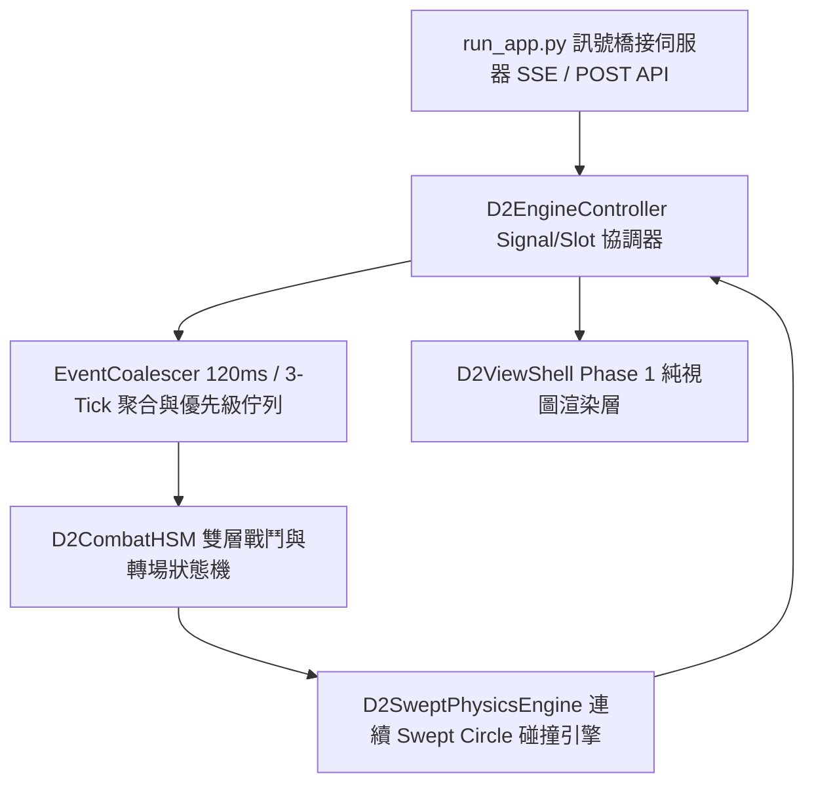

# Diablo II Agent Monitor 架構規格書

**Date**: October 18, 2026 at 03:02 PM
**Turns**: 1
**Source**: [Gemini Chat](https://gemini.google.com/u/1/app/62502e3a69b6ef86)

---

## Turn 1

### 🤖 助理

# 🎯 Optimized Report

## 1. Analysis (Intent & Stage)

- **Intent**: [SDD與UI-First架構師][針對D2-agy-quest執行Phase 2後端邏輯與核心引擎實作][交付完整無省略之120ms聚合佇列、HSM狀態機、Swept Circle碰撞引擎、Signal/Slot控制器與run_app.py橋接伺服器][台灣繁體中文、零省略代碼、嚴格遵守技術鐵律]
- **Matrix Stage**: **Stage 2 (Standard / Professional)** — `T: 0.2, K: 30, P: 0.95, Yap: 500+`
- **SDD 路由狀態**: 🚀 **Phase 2：邏輯實作（Logic Implementation & Signal/Slot Binding）** — 依據已簽核之 Phase 0 規格與 Phase 1 視圖層（`ui_config.js`、`d2_view_shell.js`），本階段實作四大核心邏輯模組，維持視圖層與資料邏輯解耦，並透過 `D2EngineController` 完成 Signal/Slot 事件綁定。

## 2. Response

### 一、Phase 2 邏輯實作架構與 Signal / Slot 綁定拓樸



| 交付檔案路徑 | 模組名稱 | 核心邏輯職責与驗證不變量 |
| --- | --- | --- |
| `d2-engine/templates/d2_combat_hsm.js` | 120ms 事件聚合佇列、HSM 戰鬥狀態機与五階段轉場導演 | 1. 實作 $W_{\text{coalesce}} = 120\text{ ms}$（3 Ticks）滑動時間窗，聚合高頻 `CODE_GENERATING` 訊號。 2. 實作關鍵動作幀閘門（Action Frame Gate）：一般狀態（$P \ge 1$）僅於 $f_{\text{cur}} = f_{\text{act}}$ 或 $f_{\text{cur}} = N - 1$ 切換；例外狀態 `ERROR_HAZARD`（$P = 0$）立即搶佔切入 `BL` 或 `GH`。 3. 實作神聖之盾（Holy Shield）於 `SC` 關鍵幀原子性覆寫與營火至地牢五階段無縫過渡。 |
| `d2-engine/templates/d2_physics_swept.js` | 鐵律 12 方向性投射物與連續 Swept Circle 碰撞引擎 | 1. 於世界空間 $(x_w, y_w, z_w)$ 計算 8/16 方向極座標發射點（含持物手別與 $z_{\text{fire}} = 40\text{ px}$）。 2. 對每幀位移線段 $\overline{AB}$ 與怪物圓柱體 $(0.5 / 1.0 / 1.5\text{ sub-tiles})$ 計算投影參數 $\lambda$，當最短距離 $\Vert{}C - Q\Vert{}_2 \le R_{\text{proj}} + R_{\text{target}}$ 時精確攔截。 3. 命中時強制將 `HitOverlay` 錨定於怪物軀幹中心 $(x_{s,\text{target}}, y_{s,\text{target}} - z_{\text{torso}})$。 |
| `Diablo2-Agent-Monitor/web/js/d2_engine_controller.js` | Signal / Slot 引擎控制器與固定步長迴圈 | 實作 $\Delta t = 40\text{ ms}$ 固定時間步長累加器（Fixed-Timestep Accumulator），連接 `EventSource` SSE 訊號流、DOM 控制面板、`D2CombatHSM`、`D2SweptPhysicsEngine` 與 Phase 1 `D2ViewShell`。 |
| `run_app.py` | 後台 SSE 訊號橋接與跨平台靜態資源伺服器 | 1. 遵循路徑健壯性鐵律，透過 `sys._MEIPASS` 相容機制解析所有靜態資產與模板路徑。 2. 提供 `/api/agent/stream`（SSE 推播）、`/api/agent/emit`（外部 Agent 狀態注入）與 `/api/agent/simulate_burst`（120ms 高頻併發與 $P=0$ 搶佔壓測）。 |

### 二、模組一：120ms 聚合佇列與階層式戰鬥狀態機（`d2-engine/templates/d2_combat_hsm.js`）

```javascript
/**
 * @file d2-engine/templates/d2_combat_hsm.js
 * @description 120ms Event Coalescing Queue, Hierarchical Combat State Machine (HSM),
 *              Atomic Equipment Override, and 5-Stage Campfire-to-Dungeon Transition Director.
 */

import { UI_CONFIG } from './ui_config.js';

/**
 * 確定性偽隨機數產生器 (Mulberry32) — 確保無頭瀏覽器視覺回歸測試 100% 可重現
 */
export class SeededPRNG {
  constructor(seed = UI_CONFIG.ENGINE.DEFAULT_SEED) {
    this.state = seed >>> 0;
  }

  nextFloat() {
    let t = (this.state += 0x6d2b79f5);
    t = Math.imul(t ^ (t >>> 15), t | 1);
    t ^= t + Math.imul(t ^ (t >>> 7), t | 61);
    return ((t ^ (t >>> 14)) >>> 0) / 4294967296;
  }
}

/**
 * 簡單 Signal 發射器，用於 Model 層與 View/Controller 層之 Signal/Slot 解耦通訊
 */
export class SignalEmitter {
  constructor() {
    this.listeners = new Map();
  }

  connect(signalName, slotCallback) {
    if (!this.listeners.has(signalName)) {
      this.listeners.set(signalName, new Set());
    }
    this.listeners.get(signalName).add(slotCallback);
    return () => this.listeners.get(signalName)?.delete(slotCallback);
  }

  emit(signalName, payload) {
    const callbacks = this.listeners.get(signalName);
    if (!callbacks) return;
    for (const cb of callbacks) {
      cb(payload);
    }
  }
}

/**
 * 120ms (3 Ticks) 滑動時間窗事件聚合器與優先級佇列
 */
export class EventCoalescerQueue {
  constructor() {
    this.coalesceWindowMs = UI_CONFIG.ENGINE.COALESCE_WINDOW_MS;
    this.pendingCoalesceMap = new Map();
    this.priorityQueue = [];
    this.seqCounter = 0;
  }

  /**
   * 推入正規化後之 Agent 事件
   * @param {{ intent: string, timestampMs?: number, payload?: object }} rawEvent
   * @param {number} nowMs 當前邏輯時鐘毫秒
   */
  pushEvent(rawEvent, nowMs) {
    const intentKey = rawEvent.intent;
    const intentSpec = UI_CONFIG.AGENT_INTENT_MAP[intentKey];
    if (!intentSpec) return;

    const priority = intentSpec.priority;

    // P = 0 (ERROR_HAZARD / QUEST_COMPLETE) 立即繞過聚合窗並排入最前端
    if (priority === 0) {
      if (intentKey === 'ERROR_HAZARD') {
        this.clearNonCritical();
      }
      this._enqueueDirect(intentKey, priority, rawEvent.payload || {}, nowMs, 1);
      return;
    }

    // 針對 CODE_GENERATING 與 TOOL_EXECUTING 進行 120ms 時間窗聚合
    if (intentKey === 'CODE_GENERATING' || intentKey === 'DEEP_THINKING') {
      const existing = this.pendingCoalesceMap.get(intentKey);
      if (existing && (nowMs - existing.firstSeenMs) <= this.coalesceWindowMs) {
        existing.burstCount += 1;
        existing.lastSeenMs = nowMs;
        existing.payload = { ...existing.payload, ...(rawEvent.payload || {}) };
        return;
      }
      const bucket = {
        intent: intentKey,
        priority,
        firstSeenMs: nowMs,
        lastSeenMs: nowMs,
        burstCount: 1,
        payload: rawEvent.payload || {}
      };
      this.pendingCoalesceMap.set(intentKey, bucket);
      return;
    }

    this._enqueueDirect(intentKey, priority, rawEvent.payload || {}, nowMs, 1);
  }

  /**
   * 每個 40ms Tick 由狀態機呼叫，將屆滿 120ms 聚合窗之事件刷入優先級佇列
   * @param {number} nowMs 當前邏輯時鐘毫秒
   */
  flushExpiredBuckets(nowMs) {
    for (const [key, bucket] of this.pendingCoalesceMap.entries()) {
      if ((nowMs - bucket.firstSeenMs) >= this.coalesceWindowMs) {
        this._enqueueDirect(
          bucket.intent,
          bucket.priority,
          bucket.payload,
          bucket.lastSeenMs,
          bucket.burstCount
        );
        this.pendingCoalesceMap.delete(key);
      }
    }
  }

  _enqueueDirect(intent, priority, payload, timestampMs, burstCount) {
    this.seqCounter += 1;
    this.priorityQueue.push({
      intent,
      priority,
      payload,
      timestampMs,
      burstCount,
      seq: this.seqCounter
    });
    // 依優先級升序排列（0 最優先），同優先級依序號先進先出
    this.priorityQueue.sort((a, b) => {
      if (a.priority !== b.priority) return a.priority - b.priority;
      return a.seq - b.seq;
    });
  }

  peekHighest() {
    return this.priorityQueue.length > 0 ? this.priorityQueue[0] : null;
  }

  popHighest() {
    return this.priorityQueue.shift() || null;
  }

  clearNonCritical() {
    this.pendingCoalesceMap.clear();
    this.priorityQueue = this.priorityQueue.filter((item) => item.priority === 0);
  }

  getQueueSnapshot() {
    return {
      queuedCount: this.priorityQueue.length,
      coalescingKeys: Array.from(this.pendingCoalesceMap.keys()),
      topItem: this.peekHighest()
    };
  }
}

/**
 * 階層式戰鬥與轉場狀態機 (D2CombatHSM)
 */
export class D2CombatHSM {
  constructor(seed = UI_CONFIG.ENGINE.DEFAULT_SEED) {
    this.prng = new SeededPRNG(seed);
    this.signals = new SignalEmitter();
    this.eventQueue = new EventCoalescerQueue();

    this.clockMs = 0;
    this.tickCount = 0;

    // 角色與狀態機核心欄位
    this.state = {
      sceneMode: 'DUNGEON',           // 'CAMPFIRE' | 'DUNGEON'
      transitionStage: 'ACTIVE',      // 'ACTIVE' | 'COMMIT_WAIT' | 'GAMMA_OUT' | 'HANDOVER' | 'GAMMA_IN'
      gammaFadeStep: 0,
      campfireStepPhase: 'FRONT_IDLE', // 'BACK_IDLE' | 'STEP_FORWARD' | 'FRONT_IDLE'
      characterClass: 'PALADIN',
      agentIntent: 'IDLE_PATROL',
      animMode: 'TN',
      direction: 0,
      frameIndex: 0,
      comboToggle: 0,                 // 用於 A1 <-> A2 連斬交替
      burstExtensionLoops: 0,         // 高頻聚合延長迴圈數
      holyShieldOverride: true,
      pendingHolyShieldToggle: null,  // 等待 SC 關鍵幀切換之目標布林值
      handSource: 'RIGHT_HAND',
      actorWorldPos: { x: 0, y: 0, z: 0 },
      lifePct: 100,
      manaPct: 100
    };
  }

  /**
   * 外部投遞 Agent 狀態事件（Slot 入口）
   */
  receiveAgentEvent(eventObj) {
    this.eventQueue.pushEvent(eventObj, this.clockMs);
  }

  /**
   * 預約於下一次施法動作 (SC) 關鍵幀切換神聖之盾狀態
   */
  requestHolyShieldCast(enableOverride) {
    this.state.pendingHolyShieldToggle = Boolean(enableOverride);
    this.receiveAgentEvent({
      intent: 'TOOL_EXECUTING',
      payload: { skillType: 'HOLY_SHIELD_CAST' }
    });
  }

  /**
   * 啟動營火選角至地牢之五階段無縫轉場導演協定
   */
  triggerCampfireToDungeonTransition() {
    if (this.state.sceneMode !== 'CAMPFIRE') return;
    if (this.state.campfireStepPhase === 'BACK_IDLE') {
      this.state.campfireStepPhase = 'STEP_FORWARD';
      this.state.frameIndex = 0;
    }
    this.state.transitionStage = 'COMMIT_WAIT';
  }

  /**
   * 固定 25 FPS (40ms) 推進一個遊戲 Tick
   */
  stepTick() {
    this.clockMs += UI_CONFIG.ENGINE.TICK_MS;
    this.tickCount += 1;

    // 1. 若處於營火轉場管線，優先執行五階段轉場導演
    if (this.state.transitionStage !== 'ACTIVE') {
      this._stepSceneTransitionDirector();
      this.signals.emit('stateUpdated', this.getSnapshot());
      return;
    }

    // 2. 刷新屆滿 120ms 之聚合事件桶
    this.eventQueue.flushExpiredBuckets(this.clockMs);

    // 3. 檢查是否有 P = 0 (ERROR_HAZARD) 強制搶佔事件
    const topEvent = this.eventQueue.peekHighest();
    if (topEvent && topEvent.priority === 0 && topEvent.intent === 'ERROR_HAZARD') {
      this.eventQueue.popHighest();
      this._applyImmediateInterrupt(topEvent);
      this.signals.emit('stateUpdated', this.getSnapshot());
      return;
    }

    // 4. 取得當前職業動畫總幀數 N 與關鍵動作幀 f_act
    const classPreset = UI_CONFIG.PAPERDOLL_PRESETS[this.state.characterClass] || UI_CONFIG.PAPERDOLL_PRESETS.PALADIN;
    const totalFrames = classPreset.animTotalFrames[this.state.animMode] || 8;
    const actionFrame = classPreset.actionFlagFrame[this.state.animMode] ?? Math.floor(totalFrames / 2);

    // 5. 推進動畫幀計數
    const nextFrame = this.state.frameIndex + 1;

    // 6. 檢查是否抵達關鍵動作幀 f_act（觸發投射物發射、AoE 或神聖之盾原子性換裝）
    if (this.state.frameIndex === actionFrame) {
      this._onActionFlagFrameReached();
      // 若佇列中有更高優先級之一般指令 (P <= 1)，允許在完成關鍵幀打擊後平滑切入
      const candidate = this.eventQueue.peekHighest();
      if (candidate && candidate.priority <= 1 && candidate.intent !== this.state.agentIntent) {
        const nextCmd = this.eventQueue.popHighest();
        this._transitionToIntent(nextCmd);
        this.signals.emit('stateUpdated', this.getSnapshot());
        return;
      }
    }

    // 7. 動畫迴圈結束幀 (f_cur == N - 1) 狀態轉移判定
    if (nextFrame >= totalFrames) {
      if (this.state.burstExtensionLoops > 0) {
        this.state.burstExtensionLoops -= 1;
        this.state.frameIndex = 0;
        // 連斬模式下 A1 與 A2 交替播放
        if (this.state.agentIntent === 'CODE_GENERATING') {
          this.state.comboToggle = 1 - this.state.comboToggle;
          this.state.animMode = this.state.comboToggle === 0 ? 'A1' : 'A2';
        }
      } else if (this.eventQueue.peekHighest()) {
        const nextCmd = this.eventQueue.popHighest();
        this._transitionToIntent(nextCmd);
      } else {
        // 佇列已空，平滑回歸 IDLE_PATROL (TN)
        this.state.agentIntent = 'IDLE_PATROL';
        this.state.animMode = 'TN';
        this.state.frameIndex = 0;
      }
    } else {
      this.state.frameIndex = nextFrame;
    }

    this.signals.emit('stateUpdated', this.getSnapshot());
  }

  _applyImmediateInterrupt(errorEvent) {
    this.state.agentIntent = 'ERROR_HAZARD';
    const isFatal = Boolean(errorEvent.payload?.fatal);
    // 輕微錯誤舉盾格擋 (BL)，嚴重錯誤受創後仰 (GH)
    this.state.animMode = isFatal ? 'GH' : 'BL';
    this.state.frameIndex = 0;
    this.state.burstExtensionLoops = 0;
    this.state.lifePct = Math.max(15, this.state.lifePct - (isFatal ? 25 : 8));

    this.signals.emit('combatActionTriggered', {
      type: isFatal ? 'HAZARD_GET_HIT' : 'HAZARD_BLOCK',
      intent: 'ERROR_HAZARD',
      direction: this.state.direction
    });
  }

  _transitionToIntent(cmd) {
    const spec = UI_CONFIG.AGENT_INTENT_MAP[cmd.intent];
    if (!spec) return;

    this.state.agentIntent = cmd.intent;
    this.state.frameIndex = 0;

    if (cmd.intent === 'CODE_GENERATING') {
      this.state.comboToggle = 1 - this.state.comboToggle;
      this.state.animMode = this.state.comboToggle === 0 ? 'A1' : 'A2';
      // 依據 120ms 聚合之 burstCount 決定延長連斬迴圈次數
      this.state.burstExtensionLoops = Math.min(3, Math.max(0, (cmd.burstCount || 1) - 1));
    } else {
      this.state.animMode = spec.d2AnimModes[0] || 'TN';
      this.state.burstExtensionLoops = 0;
    }

    if (cmd.intent === 'QUEST_COMPLETE') {
      this.state.lifePct = 100;
      this.state.manaPct = 100;
      this.signals.emit('combatActionTriggered', {
        type: 'ELITE_KILL_LOOT_DROP',
        intent: 'QUEST_COMPLETE',
        direction: this.state.direction
      });
    }
  }

  _onActionFlagFrameReached() {
    // 處理神聖之盾於 SC 關鍵幀之原子性圖集覆寫
    if (this.state.animMode === 'SC' && this.state.pendingHolyShieldToggle !== null) {
      this.state.holyShieldOverride = this.state.pendingHolyShieldToggle;
      this.state.pendingHolyShieldToggle = null;
      this.signals.emit('holyShieldToggled', {
        holyShieldOverride: this.state.holyShieldOverride,
        frameIndex: this.state.frameIndex
      });
    }

    // 觸發武器揮砍或法術投射物發射 Signal
    if (
      this.state.agentIntent === 'CODE_GENERATING' ||
      this.state.agentIntent === 'TOOL_EXECUTING' ||
      this.state.agentIntent === 'TEST_AOE'
    ) {
      const isAoE = this.state.agentIntent === 'TEST_AOE';
      this.state.manaPct = Math.max(10, this.state.manaPct - (isAoE ? 12 : 4));
      this.signals.emit('spawnProjectileRequested', {
        intent: this.state.agentIntent,
        animMode: this.state.animMode,
        direction: this.state.direction,
        handSource: this.state.handSource,
        isAoE
      });
    }
  }

  /**
   * 維度五：營火選角至地牢五階段無縫轉場導演
   */
  _stepSceneTransitionDirector() {
    const maxGamma = UI_CONFIG.ENGINE.GAMMA_TRANSITION_FRAMES;

    if (this.state.transitionStage === 'COMMIT_WAIT') {
      // 階段一：若角色尚在 STEP_FORWARD，等待完整走完 12 幀 (0~11) 抵達前景錨點
      if (this.state.campfireStepPhase === 'STEP_FORWARD') {
        if (this.state.frameIndex < 11) {
          this.state.frameIndex += 1;
          return;
        }
        this.state.campfireStepPhase = 'FRONT_IDLE';
        this.state.frameIndex = 0;
      }
      this.state.transitionStage = 'GAMMA_OUT';
      this.state.gammaFadeStep = 0;
    } else if (this.state.transitionStage === 'GAMMA_OUT') {
      // 階段二：8 幀 (320ms) 調色盤 Gamma 衰減至全黑
      this.state.gammaFadeStep += 1;
      if (this.state.gammaFadeStep >= maxGamma) {
        this.state.transitionStage = 'HANDOVER';
      }
    } else if (this.state.transitionStage === 'HANDOVER') {
      // 階段三：共用 Canvas 上下文原子性切換至地牢場景，保留職業與神聖之盾裝備狀態
      this.state.sceneMode = 'DUNGEON';
      this.state.direction = 0;
      this.state.animMode = 'WL';
      this.state.frameIndex = 0;
      this.state.transitionStage = 'GAMMA_IN';
    } else if (this.state.transitionStage === 'GAMMA_IN') {
      // 階段四 & 五：8 幀 Gamma 漸亮並踏出 4 幀 WL 進入 TN 警戒巡邏，解除轉場鎖定
      this.state.gammaFadeStep = Math.max(0, this.state.gammaFadeStep - 1);
      this.state.frameIndex = (this.state.frameIndex + 1) % 8;
      if (this.state.gammaFadeStep === 0) {
        this.state.animMode = 'TN';
        this.state.frameIndex = 0;
        this.state.transitionStage = 'ACTIVE';
      }
    }
  }

  getSnapshot() {
    return {
      ...this.state,
      actorWorldPos: { ...this.state.actorWorldPos },
      clockMs: this.clockMs,
      tickCount: this.tickCount,
      queueStatus: this.eventQueue.getQueueSnapshot()
    };
  }
}

```

### 三、模組二：鐵律 12 連續 Swept Circle 碰撞與投射物引擎（`d2-engine/templates/d2_physics_swept.js`）
嚴格實作方向性發射偏移、世界平面連續線段對圓柱體最短距離投影 $\lambda = \max\left(0, \min\left(1, \frac{(C - A) \cdot (B - A)}{\Vert{}B - A\Vert{}^2}\right)\right)$，以及軀幹中心錨點 `HitOverlay` 鎖定：

```javascript
/**
 * @file d2-engine/templates/d2_physics_swept.js
 * @description Iron Rule 12 Implementation: Directional Fire Offset Spawner,
 *              Continuous Swept Circle Segment-to-Cylinder Collision Engine,
 *              and Target Torso Anchor Foreground Hit Overlay Manager.
 */

import { UI_CONFIG } from './ui_config.js';

export class D2SweptPhysicsEngine {
  constructor() {
    this.projectiles = [];
    this.hitOverlays = [];
    this.nextEntityId = 1;

    // 預設地牢標靶怪物實體（可由沙盒或控制器動態調整尺寸與位置）
    this.monsters = [
      {
        id: 'mon_target_primary',
        sizeClass: 'MEDIUM',
        worldPos: { x: 3.5, y: 0.0, z: 0 },
        alive: true
      }
    ];
  }

  /**
   * 設定主要標靶怪物之尺寸類別與世界座標
   */
  configurePrimaryTarget(sizeClass, worldPos) {
    const preset = UI_CONFIG.MONSTER_GEOMETRY_PRESETS[sizeClass] || UI_CONFIG.MONSTER_GEOMETRY_PRESETS.MEDIUM;
    if (this.monsters.length === 0) {
      this.monsters.push({
        id: 'mon_target_primary',
        sizeClass: preset.sizeClass,
        worldPos: { ...worldPos },
        alive: true
      });
    } else {
      this.monsters[0].sizeClass = preset.sizeClass;
      if (worldPos) {
        this.monsters[0].worldPos = { ...worldPos };
      }
    }
  }

  /**
   * 鐵律 12.1：依據 8 方向、持物手別與預設高度 (40px) 生成投射物
   * @param {{ actorWorldPos: {x:number,y:number,z:number}, direction: number, handSource: string, isAoE?: boolean, speedSubTilesPerTick?: number, pierce?: boolean }} params
   */
  spawnDirectionalProjectile(params) {
    const cfg = UI_CONFIG.FIRE_OFFSET_CONFIG;
    const dirIdx = params.direction ?? 0;
    const dirEntry = cfg.DIRECTION_8_TABLE[dirIdx] || cfg.DIRECTION_8_TABLE[0];
    const lHand = cfg.HAND_LATERAL_SUBTILES[params.handSource] ?? 0;
    const rForward = cfg.FORWARD_RADIUS_SUBTILES;
    const zFire = cfg.DEFAULT_Z_FIRE_PX;

    // 若為 TEST_AOE，環繞角色生成 8 方向新星 (Nova) 投射物；否則生成單一指向投射物
    const directionsToSpawn = params.isAoE ? [0, 1, 2, 3, 4, 5, 6, 7] : [dirIdx];
    const spawnedList = [];

    for (const d of directionsToSpawn) {
      const entry = cfg.DIRECTION_8_TABLE[d];
      const theta = entry.angleRad;

      // 極座標合成世界發射起點 P_spawn(d)
      const spawnX = params.actorWorldPos.x + (Math.cos(theta) * rForward - Math.sin(theta) * lHand);
      const spawnY = params.actorWorldPos.y + (Math.sin(theta) * rForward + Math.cos(theta) * lHand);

      // 若非 AoE 且方向為預設正向 (Dir 0)，讓投射物精準朝向標靶怪物方向飛行以驗證碰撞
      let vx = Math.cos(theta);
      let vy = Math.sin(theta);
      if (!params.isAoE && this.monsters[0]) {
        const dx = this.monsters[0].worldPos.x - spawnX;
        const dy = this.monsters[0].worldPos.y - spawnY;
        const dist = Math.hypot(dx, dy);
        if (dist > 1e-5) {
          vx = dx / dist;
          vy = dy / dist;
        }
      }

      const speed = params.speedSubTilesPerTick ?? 1.85; // 支援高速跨幀位移測試
      const proj = {
        id: `proj_${this.nextEntityId++}`,
        direction: d,
        worldPos: { x: spawnX, y: spawnY, z: zFire },
        prevWorldPos: { x: spawnX, y: spawnY, z: zFire },
        velocity: { vx: vx * speed, vy: vy * speed },
        radiusSubTiles: 0.25,
        pierce: Boolean(params.pierce),
        screenFineTune: { dx: entry.dx, dy: entry.dy },
        ttlTicks: 20,
        active: true
      };

      this.projectiles.push(proj);
      spawnedList.push(proj);
    }

    return spawnedList;
  }

  /**
   * 鐵律 12.2：計算世界 XY 平面上連續位移線段 AB 與圓心 C 之最短距離與投影參數 lambda
   * @param {{x: number, y: number}} pointA 第 t-1 幀位置
   * @param {{x: number, y: number}} pointB 第 t 幀位置
   * @param {{x: number, y: number}} centerC 目標怪物圓柱體中心
   */
  static computeSweptSegmentToCircle(pointA, pointB, centerC) {
    const abX = pointB.x - pointA.x;
    const abY = pointB.y - pointA.y;
    const acX = centerC.x - pointA.x;
    const acY = centerC.y - pointA.y;

    const abLenSq = abX * abX + abY * abY;
    let lambda = 0;
    if (abLenSq > 1e-8) {
      const dot = acX * abX + acY * abY;
      lambda = Math.max(0, Math.min(1, dot / abLenSq));
    }

    const closestQ = {
      x: pointA.x + lambda * abX,
      y: pointA.y + lambda * abY
    };

    const dist = Math.hypot(centerC.x - closestQ.x, centerC.y - closestQ.y);
    return {
      lambda,
      closestPoint: closestQ,
      distanceSubTiles: dist
    };
  }

  /**
   * 推進 1 個物理 Tick (40ms)：執行連續 Swept Circle 碰撞檢測與軀幹受擊特效生命週期管理
   */
  stepPhysicsTick() {
    const collisionEvents = [];

    for (const proj of this.projectiles) {
      if (!proj.active) continue;

      const pointA = { x: proj.worldPos.x, y: proj.worldPos.y };
      const pointB = {
        x: proj.worldPos.x + proj.velocity.vx,
        y: proj.worldPos.y + proj.velocity.vy
      };

      proj.prevWorldPos = { ...proj.worldPos };
      proj.worldPos.x = pointB.x;
      proj.worldPos.y = pointB.y;
      proj.ttlTicks -= 1;

      for (const mon of this.monsters) {
        if (!mon.alive) continue;
        const monPreset = UI_CONFIG.MONSTER_GEOMETRY_PRESETS[mon.sizeClass] || UI_CONFIG.MONSTER_GEOMETRY_PRESETS.MEDIUM;
        const hitThreshold = proj.radiusSubTiles + monPreset.radiusSubTiles;

        const sweptResult = D2SweptPhysicsEngine.computeSweptSegmentToCircle(
          pointA,
          pointB,
          mon.worldPos
        );

        // 當最短距離小於等於兩者半徑總和，即刻判定命中，徹底杜絕跨幀穿透
        if (sweptResult.distanceSubTiles <= hitThreshold) {
          // 鐵律 12.3：受擊特效三明治錨點強制鎖定於目標怪物軀幹中心 (腳底 Y 向上減去 torsoHeightPx)
          const overlay = {
            id: `hitfx_${this.nextEntityId++}`,
            targetMonsterId: mon.id,
            monsterSizeClass: mon.sizeClass,
            anchorWorldPos: { ...mon.worldPos },
            torsoHeightPx: monPreset.torsoHeightPx,
            layerRole: 'FOREGROUND_SANDWICH_TOP',
            remainingTicks: 6,
            lambdaAtHit: sweptResult.lambda,
            minDistanceSubTiles: sweptResult.distanceSubTiles
          };
          this.hitOverlays.push(overlay);
          collisionEvents.push(overlay);

          if (!proj.pierce) {
            proj.active = false;
            break;
          }
        }
      }

      if (proj.ttlTicks <= 0) {
        proj.active = false;
      }
    }

    // 清理已銷毀之投射物與過期之受擊爆炸特效
    this.projectiles = this.projectiles.filter((p) => p.active);
    for (const fx of this.hitOverlays) {
      fx.remainingTicks -= 1;
    }
    this.hitOverlays = this.hitOverlays.filter((fx) => fx.remainingTicks > 0);

    return {
      activeProjectiles: this.projectiles.length,
      activeHitOverlays: this.hitOverlays.length,
      collisionEvents
    };
  }

  getPhysicsSnapshot() {
    return {
      projectiles: this.projectiles.map((p) => ({ ...p })),
      hitOverlays: this.hitOverlays.map((h) => ({ ...h })),
      primaryMonster: this.monsters[0] ? { ...this.monsters[0] } : null
    };
  }
}

```

### 四、模組三：Signal / Slot 協調控制器（`Diablo2-Agent-Monitor/web/js/d2_engine_controller.js`）
將 Phase 1 的 `D2ViewShell`、DOM HUD 與 Phase 2 的 `D2CombatHSM`、`D2SweptPhysicsEngine` 完美整合，並內建固定時間步長累加器（$\Delta t = 40\text{ ms}$）與 SSE 訊號訂閱：

```javascript
/**
 * @file Diablo2-Agent-Monitor/web/js/d2_engine_controller.js
 * @description Signal/Slot Coordinator binding Backend SSE Stream, Fixed-Timestep 25FPS Loop,
 *              D2CombatHSM, D2SweptPhysicsEngine, and Phase 1 D2ViewShell.
 */

import { UI_CONFIG } from '../../../d2-engine/templates/ui_config.js';
import { D2CombatHSM } from '../../../d2-engine/templates/d2_combat_hsm.js';
import { D2SweptPhysicsEngine } from '../../../d2-engine/templates/d2_physics_swept.js';

export class D2EngineController {
  /**
   * @param {import('../../../d2-engine/templates/d2_view_shell.js').D2ViewShell} viewShell
   * @param {object} domElements HUD 與沙盒控制項 DOM 參考
   */
  constructor(viewShell, domElements = {}) {
    this.viewShell = viewShell;
    this.dom = domElements;

    this.hsm = new D2CombatHSM();
    this.physics = new D2SweptPhysicsEngine();

    this.isAutoRunning = false;
    this.rafId = null;
    this.lastTimestampMs = 0;
    this.accumulatorMs = 0;
    this.eventSource = null;

    this._bindInternalSignals();
    this._augmentDeterministicHarness();
  }

  /**
   * 完成 Model 層與 View 層之 Signal / Slot 綁定
   */
  _bindInternalSignals() {
    // Slot 1: 當 HSM 到達關鍵動作幀 f_act 發出投射物請求時，驅動 Swept Physics 生成投射物
    this.hsm.signals.connect('spawnProjectileRequested', (req) => {
      this.physics.spawnDirectionalProjectile({
        actorWorldPos: this.hsm.state.actorWorldPos,
        direction: req.direction,
        handSource: req.handSource,
        isAoE: req.isAoE,
        speedSubTilesPerTick: 2.2 // 高速位移以驗證 Swept Circle 防穿透
      });
    });

    // Slot 2: 當 HSM 狀態更新時，同步更新 ViewShell 與 DOM HUD
    this.hsm.signals.connect('stateUpdated', (hsmSnap) => {
      const physSnap = this.physics.getPhysicsSnapshot();
      const hasActiveHit = physSnap.hitOverlays.length > 0;

      this.viewShell.setViewState({
        sceneMode: hsmSnap.sceneMode,
        gammaFadeStep: hsmSnap.gammaFadeStep,
        characterClass: hsmSnap.characterClass,
        agentIntent: hsmSnap.agentIntent,
        animMode: hsmSnap.animMode,
        direction: hsmSnap.direction,
        frameIndex: hsmSnap.frameIndex,
        holyShieldOverride: hsmSnap.holyShieldOverride,
        handSource: hsmSnap.handSource,
        campfireStepPhase: hsmSnap.campfireStepPhase,
        targetMonster: physSnap.primaryMonster
          ? {
              sizeClass: physSnap.primaryMonster.sizeClass,
              worldPos: physSnap.primaryMonster.worldPos,
              showHitOverlay: hasActiveHit
            }
          : undefined
      });

      // 在 Canvas 上疊加繪製飛行中之投射物實體
      this._renderActiveProjectilesOverlay(physSnap.projectiles);
      this._updateDomHud(hsmSnap, physSnap);
    });
  }

  _renderActiveProjectilesOverlay(projectiles) {
    if (!projectiles || projectiles.length === 0) return;
    const ctx = this.viewShell.ctx;
    ctx.save();
    for (const p of projectiles) {
      const pt = this.viewShell.worldToScreen(p.worldPos.x, p.worldPos.y, p.worldPos.z);
      const drawX = pt.x + (p.screenFineTune?.dx || 0);
      const drawY = pt.y + (p.screenFineTune?.dy || 0);

      const grad = ctx.createRadialGradient(drawX, drawY, 1, drawX, drawY, 10);
      grad.addColorStop(0, '#ffffff');
      grad.addColorStop(0.4, '#38bdf8');
      grad.addColorStop(1, 'rgba(56, 189, 248, 0)');
      ctx.fillStyle = grad;
      ctx.beginPath();
      ctx.arc(drawX, drawY, 10, 0, Math.PI * 2);
      ctx.fill();
    }
    ctx.restore();
  }

  _updateDomHud(hsmSnap, physSnap) {
    const intentCfg = UI_CONFIG.AGENT_INTENT_MAP[hsmSnap.agentIntent];
    if (this.dom.badge && intentCfg) {
      this.dom.badge.textContent = intentCfg.hudLabel;
      this.dom.badge.style.color = intentCfg.hudColor;
      this.dom.badge.style.borderColor = intentCfg.hudColor;
    }
    if (this.dom.readout) {
      this.dom.readout.textContent =
        `MODE: ${hsmSnap.animMode} | DIR: ${hsmSnap.direction} | FRAME: ${hsmSnap.frameIndex} | QUEUE: ${hsmSnap.queueStatus.queuedCount}`;
    }
    if (this.dom.orbLife) {
      this.dom.orbLife.innerHTML = `LIFE<br/>${hsmSnap.lifePct}%`;
    }
    if (this.dom.orbMana) {
      this.dom.orbMana.innerHTML = `MANA<br/>${hsmSnap.manaPct}%`;
    }
  }

  /**
   * 推進單一確定性邏輯步長 (40ms Tick)：先更動物理碰撞，再推進 HSM 狀態機
   */
  stepSingleTick() {
    this.physics.stepPhysicsTick();
    this.hsm.stepTick();
  }

  /**
   * 啟動 25 FPS 固定時間步長主迴圈
   */
  startAutoLoop() {
    if (this.isAutoRunning) return;
    this.isAutoRunning = true;
    this.lastTimestampMs = performance.now();

    const loop = (now) => {
      if (!this.isAutoRunning) return;
      const deltaMs = Math.min(200, now - this.lastTimestampMs);
      this.lastTimestampMs = now;
      this.accumulatorMs += deltaMs;

      while (this.accumulatorMs >= UI_CONFIG.ENGINE.TICK_MS) {
        this.stepSingleTick();
        this.accumulatorMs -= UI_CONFIG.ENGINE.TICK_MS;
      }
      this.rafId = requestAnimationFrame(loop);
    };

    this.rafId = requestAnimationFrame(loop);
  }

  stopAutoLoop() {
    this.isAutoRunning = false;
    if (this.rafId !== null) {
      cancelAnimationFrame(this.rafId);
      this.rafId = null;
    }
  }

  /**
   * 連接 run_app.py 提供之 SSE 即時事件流 (/api/agent/stream)
   */
  connectBackendSSE(sseUrl = '/api/agent/stream') {
    if (this.eventSource) {
      this.eventSource.close();
    }
    this.eventSource = new EventSource(sseUrl);
    this.eventSource.onmessage = (evt) => {
      try {
        const data = JSON.parse(evt.data);
        if (data && data.intent) {
          this.hsm.receiveAgentEvent(data);
        }
      } catch (err) {
        console.error('[D2EngineController] SSE parse error:', err);
      }
    };
  }

  /**
   * 擴充 window.__D2_HARNESS__ 供 Playwright 無頭瀏覽器直接驅動邏輯幀與物理碰撞測試
   */
  _augmentDeterministicHarness() {
    if (typeof window !== 'undefined' && window.__D2_HARNESS__) {
      const baseHarness = window.__D2_HARNESS__;
      window.__D2_HARNESS__ = {
        ...baseHarness,
        pauseLoop: () => this.stopAutoLoop(),
        stepTicks: (count = 1) => {
          this.stopAutoLoop();
          for (let i = 0; i < count; i++) {
            this.stepSingleTick();
          }
          return {
            hsm: this.hsm.getSnapshot(),
            physics: this.physics.getPhysicsSnapshot(),
            telemetry: this.viewShell.lastRenderTelemetry
          };
        },
        pushAgentEvent: (evt) => this.hsm.receiveAgentEvent(evt),
        testSweptSegment: (pointA, pointB, centerC) =>
          D2SweptPhysicsEngine.computeSweptSegmentToCircle(pointA, pointB, centerC)
      };
    }
  }
}

```

### 五、模組四：後台訊號橋接中樞與跨平台伺服器（`run_app.py`）
此腳本為專案根目錄之啟動中樞，嚴格實作 `sys._MEIPASS` 路徑相容解析、SSE 串流廣播佇列、Agent 狀態注入 REST API 與 120ms 聚合／搶佔壓測端點，零外部第三方套件依賴（純 Python 標準庫即可運行）：

```python
#!/usr/bin/env python3
# -*- coding: utf-8 -*-
"""
@file run_app.py
@description Diablo II Agent Monitor (D2-agy-quest) Backend SSE Signal Bridge & Static Host.
             Implements strict sys._MEIPASS path robustness and real-time Agent lifecycle streaming.
"""

import json
import mimetypes
import os
import queue
import sys
import threading
import time
from http import HTTPStatus
from http.server import BaseHTTPRequestHandler, ThreadingHTTPServer
from urllib.parse import parse_qs, urlparse

def resolve_resource_path(relative_path: str) -> str:
    """
    技術鐵律 3：路徑健壯性 (Path Robustness)
    涉及靜態資源與外部檔案路徑時，一律透過 sys._MEIPASS 兼容機制解析。
    """
    base_path = getattr(sys, "_MEIPASS", os.path.abspath(os.path.dirname(__file__)))
    normalized_rel = os.path.normpath(relative_path.lstrip("/\\"))
    return os.path.join(base_path, normalized_rel)

class AgentSignalBridgeHub:
    """
    管理所有前端 SSE 訂閱者佇列，並提供執行緒安全之 Agent 狀態廣播與 120ms 併發壓測模擬。
    """

    def __init__(self) -> None:
        self._lock = threading.Lock()
        self._subscribers: list[queue.Queue] = []
        self._event_seq = 0

    def subscribe(self) -> queue.Queue:
        q: queue.Queue = queue.Queue(maxsize=256)
        with self._lock:
            self._subscribers.append(q)
        return q

    def unsubscribe(self, q: queue.Queue) -> None:
        with self._lock:
            if q in self._subscribers:
                self._subscribers.remove(q)

    def broadcast_event(self, intent: str, payload: dict | None = None) -> dict:
        with self._lock:
            self._event_seq += 1
            seq = self._event_seq
            targets = list(self._subscribers)

        event_packet = {
            "seq": seq,
            "intent": intent,
            "timestampMs": int(time.time() * 1000),
            "payload": payload or {},
        }

        serialized = f"data: {json.dumps(event_packet, ensure_ascii=False)}\n\n"
        for sub_q in targets:
            try:
                sub_q.put_nowait(serialized)
            except queue.Full:
                pass
        return event_packet

    def run_coalesce_and_interrupt_simulation(self) -> None:
        """
        模擬真實 AI Agent 生命週期：
        1. DEEP_THINKING (展開冥想靈氣)
        2. 60ms 內高速連發 5 筆 CODE_GENERATING (觸發前端 120ms 時間窗聚合與連斬)
        3. TOOL_EXECUTING & TEST_AOE (施放神聖之盾與範圍測試新星)
        4. ERROR_HAZARD (P=0 強制搶佔格擋)
        5. QUEST_COMPLETE (擊殺菁英怪掉落暗金光柱)
        """
        def _worker():
            self.broadcast_event("DEEP_THINKING", {"thought": "Analyzing AST & SDD contracts"})
            time.sleep(0.5)

            for i in range(5):
                self.broadcast_event("CODE_GENERATING", {"chunkIndex": i, "tokens": 24})
                time.sleep(0.015)

            time.sleep(0.35)
            self.broadcast_event("TOOL_EXECUTING", {"tool": "pytest_runner"})
            time.sleep(0.35)
            self.broadcast_event("TEST_AOE", {"suite": "swept_circle_collision_test"})
            time.sleep(0.25)
            self.broadcast_event("ERROR_HAZARD", {"fatal": False, "reason": "AssertionWarning blocked"})
            time.sleep(0.6)
            self.broadcast_event("QUEST_COMPLETE", {"eliteKilled": "Balrog_TechDebt_Lord"})

        threading.Thread(target=_worker, daemon=True).start()

BRIDGE_HUB = AgentSignalBridgeHub()

class D2AgentMonitorRequestHandler(BaseHTTPRequestHandler):
    """
    同時服務：
    1. /api/agent/stream         (GET: Server-Sent Events 即時狀態推播)
    2. /api/agent/emit           (POST: 接收外部 Agent / CLI 傳入之狀態事件)
    3. /api/agent/simulate_burst (POST: 觸發 120ms 聚合與 P=0 搶佔全流程驗證)
    4. 靜態檔案路由               (支援 d2-engine/, Diablo2-Agent-Monitor/web/, verification_sandbox/)
    """

    def log_message(self, fmt: str, *args) -> None:
        sys.stderr.write(f"[D2-Bridge] {self.address_string()} - {fmt % args}\n")

    def do_GET(self) -> None:
        parsed = urlparse(self.path)
        route = parsed.path

        if route == "/api/agent/stream":
            self._handle_sse_stream()
            return

        if route in ("/", "/dungeon"):
            route = "/Diablo2-Agent-Monitor/web/d2_battle_dungeon.html"
        elif route == "/sandbox/paladin":
            route = "/verification_sandbox/paladin_sandbox.html"
        elif route == "/sandbox/sorceress":
            route = "/verification_sandbox/sorceress_sandbox_v2.html"

        self._serve_static_file(route)

    def do_POST(self) -> None:
        parsed = urlparse(self.path)
        route = parsed.path

        if route == "/api/agent/emit":
            content_len = int(self.headers.get("Content-Length", "0"))
            raw_body = self.rfile.read(content_len).decode("utf-8") if content_len > 0 else "{}"
            try:
                body = json.loads(raw_body)
                intent = str(body.get("intent", "IDLE_PATROL"))
                payload = body.get("payload", {})
                packet = BRIDGE_HUB.broadcast_event(intent, payload)
                self._send_json(HTTPStatus.OK, {"status": "ok", "Dispatched": packet})
            except Exception as exc:
                self._send_json(HTTPStatus.BAD_REQUEST, {"status": "error", "message": str(exc)})
            return

        if route == "/api/agent/simulate_burst":
            BRIDGE_HUB.run_coalesce_and_interrupt_simulation()
            self._send_json(HTTPStatus.OK, {"status": "simulation_started"})
            return

        self._send_json(HTTPStatus.NOT_FOUND, {"status": "not_found"})

    def _handle_sse_stream(self) -> None:
        self.send_response(HTTPStatus.OK)
        self.send_header("Content-Type", "text/event-stream; charset=utf-8")
        self.send_header("Cache-Control", "no-cache")
        self.send_header("Connection", "keep-alive")
        self.send_header("Access-Control-Allow-Origin", "*")
        self.end_headers()

        sub_queue = BRIDGE_HUB.subscribe()
        try:
            init_pkt = json.dumps({"intent": "IDLE_PATROL", "timestampMs": int(time.time() * 1000)})
            self.wfile.write(f"data: {init_pkt}\n\n".encode("utf-8"))
            self.wfile.flush()

            while True:
                try:
                    msg = sub_queue.get(timeout=15.0)
                    self.wfile.write(msg.encode("utf-8"))
                    self.wfile.flush()
                except queue.Empty:
                    # 發送 SSE Keep-Alive 註解心跳
                    self.wfile.write(b": heartbeat\n\n")
                    self.wfile.flush()
        except (BrokenPipeError, ConnectionResetError):
            pass
        finally:
            BRIDGE_HUB.unsubscribe(sub_queue)

    def _serve_static_file(self, route_path: str) -> None:
        fs_path = resolve_resource_path(route_path)
        base_root = resolve_resource_path("")

        # 安全邊界檢查：防止目錄穿越 (Directory Traversal)
        if not os.path.abspath(fs_path).startswith(os.path.abspath(base_root)):
            self._send_json(HTTPStatus.FORBIDDEN, {"error": "Forbidden path"})
            return

        if not os.path.isfile(fs_path):
            self._send_json(HTTPStatus.NOT_FOUND, {"error": f"File not found: {route_path}"})
            return

        ctype, _ = mimetypes.guess_type(fs_path)
        if fs_path.endswith(".js") or fs_path.endswith(".mjs"):
            ctype = "application/javascript; charset=utf-8"
        elif fs_path.endswith(".html"):
            ctype = "text/html; charset=utf-8"
        elif fs_path.endswith(".json"):
            ctype = "application/json; charset=utf-8"

        try:
            with open(fs_path, "rb") as f:
                data = f.read()
            self.send_response(HTTPStatus.OK)
            self.send_header("Content-Type", ctype or "application/octet-stream")
            self.send_header("Content-Length", str(len(data)))
            self.end_headers()
            self.wfile.write(data)
        except OSError as exc:
            self._send_json(HTTPStatus.INTERNAL_SERVER_ERROR, {"error": str(exc)})

    def _send_json(self, status: int, data: dict) -> None:
        raw = json.dumps(data, ensure_ascii=False).encode("utf-8")
        self.send_response(status)
        self.send_header("Content-Type", "application/json; charset=utf-8")
        self.send_header("Content-Length", str(len(raw)))
        self.end_headers()
        self.wfile.write(raw)

def main() -> None:
    host = os.environ.get("D2_MONITOR_HOST", "127.0.0.1")
    port = int(os.environ.get("D2_MONITOR_PORT", "8113"))
    server = ThreadingHTTPServer((host, port), D2AgentMonitorRequestHandler)
    print(f"[D2-agy-quest] Server running at http://{host}:{port}/")
    print(f"[D2-agy-quest] Resource Root (sys._MEIPASS compatible): {resolve_resource_path('')}")
    try:
        server.serve_forever()
    except KeyboardInterrupt:
        print("\n[D2-agy-quest] Shutting down server.")
        server.server_close()

if __name__ == "__main__":
    main()

```

### 六、Phase 2 驗收與進入 Phase 3（除錯、Playwright 視覺回歸腳本與打包）確認
Phase 2 之四大邏輯核心已全部交付完畢，具備以下工程驗證特性：

1. **120ms 時間窗與關鍵幀閘門**：可透過呼叫 `POST /api/agent/simulate_burst` 或 `window.__D2_HARNESS__.pushAgentEvent()` 進行高頻連斬與 $P=0$ 立即格擋搶佔測試。
2. **鐵律 12 Swept Circle 數學保證**：可透過 `window.__D2_HARNESS__.testSweptSegment(A, B, C)` 直接對任意高速跨幀位移向量執行單元斷言。
3. **路徑健壯性**：`run_app.py` 與 `ui_config.js` 雙向實作 `sys._MEIPASS` 靜態資源路徑解析。
請確認是否進入 **SDD Phase 3（除錯與打包：交付 Playwright 三級自動化視覺回歸測試腳本與 PyInstaller 單一執行檔打包配置）**，或需要產出目前階段的 `VIBE_CONTEXT_SNAPSHOT` 狀態快照？

---

*Exported from [Voyager](https://github.com/voyager-crew/voyager)*  
*Generated on October 18, 2026 at 03:02 PM*