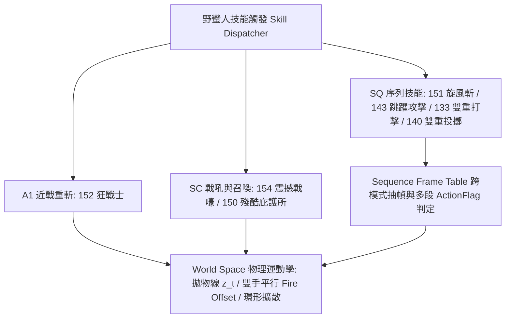

# Diablo II Agent Monitor 架構規格書

**Date**: October 18, 2026 at 03:45 PM
**Turns**: 1
**Source**: [Gemini Chat](https://gemini.google.com/u/1/app/62502e3a69b6ef86)

---

## Turn 1

### 🤖 助理

# 🎯 Optimized Report

## 1. Analysis (Intent & Stage)

- **Intent**: [暗黑II引擎與SDD架構師][針對野蠻人7項核心技能制定原廠DCC資產清單、物理運動學與Manifest配置][暫停線框與打包，輸出對齊Skills.txt與Missiles.txt之完整規格書與JSON][台灣繁體中文、零諂媚、LaTeX數理建模、完整無省略交付]
- **Matrix Stage**: **Stage 2 (Standard / Professional)** — `T: 0.2, K: 30, P: 0.95, Yap: 500+`
- **SDD 路由狀態**: 🚨 **Mode A / Phase 0-1：野蠻人（Barbarian）全技能引擎規格定義與 Manifest 資產契約交付** — 已立即中止純幾何線框與 Phase 3 打包流程，將開發重心全數收斂至 `d2-engine` 野蠻人 7 大核心技能之真實圖集載入、序列動作幀（`SQ` Sequence）、拋物線與多發射點運動學，以及可直接掛載於 `verification_sandbox/barbarian_sandbox.html` 與 `Diablo2-Agent-Monitor/web` 的完整 `barbarian_skills.manifest.json`。

## 2. Response

### 一、野蠻人（Barbarian）7 大核心技能原廠 DCC / DC6 圖集與資產清單
對標《暗黑破壞神 II》（1.13c）底層 `Skills.txt`、`Missiles.txt`、`Overlays.txt`、`PlrMode.txt` 與 `AnimData.d2`，野蠻人（角色代碼 `BA`）之複合紙娃娃路徑規則為 `data/global/chars/ba/{part}/ba{part}{armor}_{wclass}{mode}.dcc`。以下為 7 項核心技能之原廠資產與 Agent 狀態映射總表：

| 技能編號與名稱 | 映射 Agent 狀態 | 本體動作碼 (`PlrMode`) | 武器姿態碼 (`WClass`) | 原廠角色本體 DCC 序列圖集 | 投射物圖集 (`Missiles.txt` `CelFile`) | 施法 / 狀態 / 命中特效 (`Overlays.txt` & `HitSubMissile`) |
| --- | --- | --- | --- | --- | --- | --- |
| **1. 旋風斬** Whirlwind (`ID: 151`) | `CODE_GENERATING` *(長時段高頻生成)* | `SQ` *(底層抽取 `A1`/`WL` 跨方向循環幀)* | `2HS` / `STF` / `1SS` | `ba{part}{arm}_{wclass}a1.dcc` *(8 方向連續旋轉採樣)* | 無獨立飛行投射物 *(近戰範圍掃掠)* | • 腳底旋風塵土：`whirlwind.dcc` (`ba_whirlwind_dust`) • 武器殘影：`swoosh_heavy.dcc` • 命中特效：`hit_slash_blood.dcc` |
| **2. 跳躍攻擊** Leap Attack (`ID: 143`) | `TOOL_EXECUTING` *(跨模組大型重構)* | `SQ` *(三段式序列：`WL` ➔ `NU` ➔ `A1`)* | `2HS` / `STF` / `1HS` | • 起跳：`ba..._stfwl.dcc` • 滯空：`ba..._stfnu.dcc` • 劈砍：`ba..._stfa1.dcc` | 落地隱形震波： `leapattack_shock.dcc` | • 起跳揚塵：`leap_dust_cloud.dcc` • 落地裂地波：`leap_impact_ring.dcc` • 命中特效：`crush_heavy_hit.dcc` |
| **3. 雙重打擊** Double Swing (`ID: 133`) | `CODE_GENERATING` *(雙檔案併發寫入)* | `SQ` *(雙持序列：`A1` 右手 ➔ `A2` 左手)* | `1SS` / `1JS` *(雙持單手武)* | • 第一擊：`ba..._1ssa1.dcc` • 第二擊：`ba..._1ssa2.dcc` | 無 *(雙段近戰弧線判定)* | • 左右刀光：`double_swing_arc_r.dcc` / `double_swing_arc_l.dcc` • 命中特效：`hit_sparks_dual.dcc` |
| **4. 狂戰士** Berserk (`ID: 152`) | `TOOL_EXECUTING` *(高風險強制覆寫)* | `A1` *(單手/雙手極限重斬)* | `2HS` / `STF` / `1HS` | `ba{part}{arm}_{wclass}a1.dcc` | 無 *(100% 魔法傷害近戰重擊)* | • 施法武器流光：`berserk_cast_slash.dcc` • 自身破防光環：`berserk_self_debuff.dcc` • 命中魔法爆裂：`magic_hit_burst.dcc` |
| **5. 雙重投擲** Double Throw (`ID: 140`) | `CODE_GENERATING` *(非同步雙路請求)* | `SQ` *(雙投序列：`TH` 右投 ➔ `TH` 左投)* | `1SS` / `1JT` *(雙持投擲武)* | `ba{part}{arm}_1ssth.dcc` *(雙段連續抽幀)* | • 飛斧： `flyingaxe.dcc` (`balrog_spear` / `throwingaxe`) • 飛刀：`throwingknife.dcc` | • 脫手破空風壓：`throw_launch_gust.dcc` • 命中穿刺特效：`javelin_pierce_blood.dcc` |
| **6. 震撼戰嚎** War Cry (`ID: 154`) | `TEST_AOE` *(全專案併發測試)* | `SC` *(仰頭戰吼施法姿態)* | `1HS` / `1SS` / `2HS` | `ba{part}{arm}_{wclass}sc.dcc` | 16 路環形音波投射物： `warcry_ring_wave.dcc` (`warcry` missile) | • 角色吼叫氣浪：`warcry_cast_roar.dcc` • 怪物頭頂眩暈星環：`stun2.dcc` (`stun_swirl`) |
| **7. 殘酷庇護所** Grim Ward (`ID: 150`) | `DEEP_THINKING` *(建立防護邊界/沙盒隔離)* | `SC` *(指向屍體召喚動作)* | `1HS` / `1SS` / `2HS` | `ba{part}{arm}_{wclass}sc.dcc` | 召喚地面實體： `grimward_totem.dcc` (`fetish_totem`) | • 骨圖騰升起血霧：`corpse_totem_spawn.dcc` • 地面恐懼脈衝環：`grimward_pulse_ring.dcc` • 怪物恐懼詛咒：`curse_terror.dcc` |

### 二、物理運動學、序列動作表（`SQ` Sequence）與關鍵動作幀數學模型
在《暗黑破壞神 II》引擎中，凡是 `PlrMode = SQ`（Sequence）的技能，並非讀取單一 `.dcc` 檔案，而是透過 **序列索引表（Sequence Frame Table）** 將 `A1`、`A2`、`WL`、`NU`、`TH` 等基礎動作的特定幀區間拼接為複合連貫動作。以下為 7 大技能之精確運動學與幀級規格：



#### 1. 旋風斬（Whirlwind, ID: 151）—— 旋轉幀率、位移速度與多段判定頻率

- **方向旋轉速率（Directional Spin Cycling）**： 旋風斬啟動期間，角色脫離常规行走動畫，鎖定於 `A1` 揮砍第 3 至第 5 幀的持武展開姿勢，並以每個遊戲 Tick（$\Delta t = 40\text{ ms}$）順時針推進 1 個 8 方向索引（即旋轉週期 $T_{\text{rot}} = 8 \times 40\text{ ms} = 320\text{ ms}$，角速度 $\omega = \frac{\pi}{4}\text{ rad/tick}$）：$d(t) = \left(d_0 + t\right) \bmod 8$
- **線性位移速度向量（Linear Movement Velocity）**： 設起點世界座標為 $P_0 = (x_0, y_0)$，目標終點為 $P_{\text{target}} = (x_t, y_t)$，基礎移動速度為 $v_{\text{base}} = 6.0\text{ sub-tiles/s} = 0.24\text{ sub-tiles/tick}$。旋風斬速度倍率 $\eta_{\text{ww}} = 1.0 + \text{SkillLevel} \times 0.02$，每幀世界位移向量為：$\Delta \mathbf{P}_{\text{world}} = \eta_{\text{ww}} \cdot v_{\text{base}} \cdot \frac{P_{\text{target}} - P_0}{\Vert{}P_{\text{target}} - P_0\Vert{}_2}$
- **多段命中判定頻率（Hit Check Breakpoints）**： 對標原版 `Skills.txt` 機制，旋風斬在啟動後的第 $t = 4$ Tick 與第 $t = 8$ Tick 強制執行前兩次近戰範圍掃掠檢測；隨後依據武器攻速檔位（預設滿檔位 $\Delta f_{\text{hit}} = 4\text{ Ticks} = 160\text{ ms}$）週期性觸發判定。每次判定以角色當前世界座標 $(x_w, y_w)$ 為圓心、武器攻擊範圍 $R_{\text{melee}} = 2.2\text{ sub-tiles}$ 為半徑，對範圍內怪物執行圓柱體交集檢測：$\Vert{}C_{\text{monster}} - P_{\text{actor}}\Vert{}_2 \le R_{\text{melee}} + R_{\text{monster}}$

#### 2. 跳躍攻擊（Leap Attack, ID: 143）—— `SQ` 三階段狀態、滯空時間與拋物線高度方程

- **`SQ` 三階段序列拆解（Sequence #4）**：
  1. **階段一：起跳蓄力（Take-off Prep，$t \in [0, 2]$，共 3 Ticks）**：抽取 `WL` 第 0–2 幀，於 $t = 2$ 在起點腳底生成 `leap_dust_cloud.dcc`。
  2. **階段二：拋物線滯空飛行（Airborne Trajectory，$t \in [3, 3 + T_{\text{air}} - 1]$）**：鎖定抽取 `NU`（或 `A1` 第 2 幀高舉武器姿態）並隨飛行方向固定 `dir`。設起跳點為 $P_{\text{start}}$，目標落點（怪物前 $1.2\text{ sub-tiles}$ 處）為 $P_{\text{end}}$，水平總距離 $D = \Vert{}P_{\text{end}} - P_{\text{start}}\Vert{}_2$。
    - **滯空總幀數 $T_{\text{air}}$**：依距離動態計算並夾限於 $12$ 至 $22$ Ticks（$480\text{ ms}$ 至 $880\text{ ms}$）：$T_{\text{air}} = \text{clamp}\left(\left\lfloor \frac{D}{0.45} \right\rfloor,\; 12,\; 22\right)$
    - **水平等速插值與垂直拋物線高度方程 $z(u)$**：定義正規化飛行進度 $u = \frac{t - 3}{T_{\text{air}}} \in [0, 1]$，最大躍起頂點高度 $H_{\text{max}} = \min(160,\; 72 + 12 \cdot D)\text{ px}$：$\mathbf{P}_{xy}(u) = (1 - u)\mathbf{P}_{\text{start}} + u\mathbf{P}_{\text{end}}$$z(u) = 4 \cdot H_{\text{max}} \cdot u \cdot (1 - u)$其垂直速度分量為 $\frac{dz}{du} = 4 H_{\text{max}}(1 - 2u)$，完美呈現「初速急升 ➔ 最高點短暫滯空（$u=0.5$） ➔ 重力加速下墜」之原版物理手感，且地面陰影層（`Shadow`）維持在 $z = 0$ 平面隨 $\mathbf{P}_{xy}(u)$ 移動，與角色本體產生真實高度分離。
  3. **階段三：落地重劈與震波（Landing Strike，$t \in [3 + T_{\text{air}}, 3 + T_{\text{air}} + 6]$，共 7 Ticks）**：於 $u = 1.0$ 著地瞬間（$z = 0$）切換為 `A1` 第 4 至第 9 幀下劈動作，並於著地後第 2 Tick（對應 `A1` 關鍵幀 $f_{\text{act}} = 5$）同時觸發目標單體重擊與半徑 $R_{\text{shock}} = 2.0\text{ sub-tiles}$ 之 `leap_impact_ring.dcc` 擊退震波。

#### 3. 雙重打擊（Double Swing, ID: 133）與 狂戰士（Berserk, ID: 152）—— 雙持序列與魔法重斬

- **雙重打擊（Double Swing, ID: 133）**：
  - `SQ` 序列總長 $N_{\text{seq}} = 12\text{ Ticks}$（加速後標準幀數）：
    - **第 0–5 幀**：抽取 `1SS` 姿態之 `A1`（右手主武器揮擊），第一個關鍵動作幀設於 $f_{\text{act,RH}} = 3$，觸發右手扇形命中檢測與 `double_swing_arc_r.dcc`。
    - **第 6–11 幀**：無縫銜接 `1SS` 姿態之 `A2`（左手副武器揮擊），第二個關鍵動作幀設於 $f_{\text{act,LH}} = 9$，觸發左手扇形命中檢測與 `double_swing_arc_l.dcc`。
- **狂戰士（Berserk, ID: 152）**：
  - 使用標準 `A1` 動畫（總長 $N = 11\text{ Ticks}$，關鍵動作幀 $f_{\text{act}} = 5$）。
  - 於 $f = 2$ 掛載武器蓄力流光 `berserk_cast_slash.dcc`；於 $f_{\text{act}} = 5$ 觸發 $100\%$ 魔法傷害判定，在怪物軀幹錨點 $(x_{s,\text{mon}}, y_{s,\text{mon}} - z_{\text{torso}})$ 爆發 `magic_hit_burst.dcc`，同時在野蠻人自身腳底與軀幹掛載持續 50 Ticks（$2.0\text{ s}$）之紅色破防狀態環 `berserk_self_debuff.dcc`。

#### 4. 雙重投擲（Double Throw, ID: 140）—— 左右手平行雙發射點（Dual Parallel Fire Offset）

- **`SQ` 雙段投擲序列（Sequence #5）**： 序列總長 $N_{\text{seq}} = 12\text{ Ticks}$，抽取 `1SSTH`（雙持投擲）動畫幀：
  - **右手發射幀**：$f_{\text{act,RH}} = 4$，由右手極座標偏移點發射第一枚 `flyingaxe.dcc`。
  - **左手發射幀**：$f_{\text{act,LH}} = 8$（相隔 4 Ticks $= 160\text{ ms}$），由左手極座標偏移點發射第二枚 `flyingaxe.dcc`。
- **左右手雙發射點平行幾何方程（Parallel Dual Spawn Vectors）**： 設角色世界座標為 $(x_a, y_a, 0)$，面向目標之單位方向向量為 $\hat{\mathbf{u}} = (\cos\theta_d, \sin\theta_d)$，其正交側向單位向量為 $\hat{\mathbf{n}} = (-\sin\theta_d, \cos\theta_d)$。 設定前向出手順距 $R_{\text{fwd}} = 0.65\text{ sub-tiles}$，左右手側向對稱半距 $L_{\text{dual}} = 0.35\text{ sub-tiles}$（即**左右雙發射點總間距 $\Delta W_{\text{hands}} = 0.70\text{ sub-tiles} \approx 22.4\text{ px}$**），離地高度 $z_{\text{fire}} = 42\text{ px}$：$\mathbf{P}_{\text{spawn,RH}} = \begin{bmatrix} x_a \\ y_a \\ 0 \end{bmatrix} + R_{\text{fwd}} \begin{bmatrix} \cos\theta_d \\ \sin\theta_d \\ 0 \end{bmatrix} + L_{\text{dual}} \begin{bmatrix} -\sin\theta_d \\ \cos\theta_d \\ 0 \end{bmatrix} + \begin{bmatrix} 0 \\ 0 \\ 42 \end{bmatrix}$$\mathbf{P}_{\text{spawn,LH}} = \begin{bmatrix} x_a \\ y_a \\ 0 \end{bmatrix} + R_{\text{fwd}} \begin{bmatrix} \cos\theta_d \\ \sin\theta_d \\ 0 \end{bmatrix} - L_{\text{dual}} \begin{bmatrix} -\sin\theta_d \\ \cos\theta_d \\ 0 \end{bmatrix} + \begin{bmatrix} 0 \\ 0 \\ 42 \end{bmatrix}$兩枚投射物以相同速度向量 $\mathbf{V}_{\text{proj}} = v_{\text{throw}} \cdot \hat{\mathbf{u}}$（其中 $v_{\text{throw}} = 2.4\text{ sub-tiles/tick}$）平行高速飛行，並各自獨立套用**鐵律 12 之連續 Swept Circle 線段碰撞檢測**。

#### 5. 震撼戰嚎（War Cry, ID: 154）與 殘酷庇護所（Grim Ward, ID: 150）—— 同心音波擴散與骨圖騰脈衝

- **震撼戰嚎（War Cry, ID: 154）**：
  - 角色執行 `SC` 施法動作（總長 $N = 13\text{ Ticks}$，關鍵幀 $f_{\text{act}} = 6$）。
  - 於 $f_{\text{act}} = 6$ 瞬間，以角色胸口高度 $z_{\text{wave}} = 36\text{ px}$ 為中心，沿 $K = 16$ 個等分方位角 $\phi_k = \frac{2\pi k}{16}\; (k \in \{0,\dots,15\})$ 同步發射 16 枚 `warcry_ring_wave.dcc` 子投射物，構成無縫同心擴散音波環。
  - **音波擴散速度與半徑方程**：設定最大擴散半徑 $R_{\text{max}} = 5.0\text{ sub-tiles}$（對應原版 $3.33\text{ yards}$），擴散生命週期 $T_{\text{wave}} = 8\text{ Ticks}$（$320\text{ ms}$），擴散徑向速度 $v_r = \frac{5.0}{8} = 0.625\text{ sub-tiles/tick}$：$r(t) = v_r \cdot t, \quad \mathbf{P}_k(t) = \left(x_a + r(t)\cos\phi_k,\; y_a + r(t)\sin\phi_k,\; 36\right)$
  - 凡世界座標距離滿足 $\Vert{}C_{\text{monster}} - P_{\text{actor}}\Vert{}_2 \le r(t) + R_{\text{monster}}$ 之怪物，立即承受傷害並於**頭頂錨點** $(x_{s,\text{mon}}, y_{s,\text{mon}} - H_{\text{sprite}} - 12\text{ px})$ 掛載 `stun2.dcc` 旋轉星環 Overlay。
- **殘酷庇護所（Grim Ward, ID: 150）**：
  - 角色執行 `SC` 施法動作（$N = 13\text{ Ticks}$，$f_{\text{act}} = 6$），於目標座標 $(x_{\text{ward}}, y_{\text{ward}}, 0)$ 銷毀屍體並升起 `grimward_totem.dcc`（分為 `spawn: 10 幀` ➔ `loop: 持續駐留` ➔ `despawn: 8 幀`）。
  - 圖騰存續期間（預設 $250\text{ Ticks} = 10\text{ s}$），每間隔 $\Delta T_{\text{pulse}} = 25\text{ Ticks}$（$1.0\text{ s}$）向周圍半徑 $R_{\text{fear}} = 6.0\text{ sub-tiles}$ 發出一次 `grimward_pulse_ring.dcc` 地表恐懼波，為範圍內怪物掛載頭頂 `curse_terror.dcc` 並強制將怪物移動向量反轉為背離圖騰方向 $\hat{\mathbf{v}}_{\text{flee}} = \frac{C_{\text{monster}} - P_{\text{ward}}}{\Vert{}C_{\text{monster}} - P_{\text{ward}}\Vert{}_2}$。

#### 6. Given / When / Then 驗收邊界條件（SDD Acceptance Criteria）

- **Given** 野蠻人於座標 $(0, 0, 0)$ 對距離 $D = 6.5\text{ sub-tiles}$ 處的標靶怪物發動 `ID: 143 跳躍攻擊 (Leap Attack)`，
- **When** 狀態機進入 `SQ` 序列第 2 階段（`Airborne`），
- **Then** 滯空幀數必須精確鎖定為 $T_{\text{air}} = \text{clamp}(\lfloor 6.5 / 0.45 \rfloor, 12, 22) = 14\text{ Ticks}$，在飛行中點（第 7 滯空幀，$u = 0.5$）角色離地高度必須達到峰值 $z(0.5) = 150\text{ px}$，且地面陰影必須維持於 $z = 0$ 直線前進，著地後第 2 幀精準觸發 `leap_impact_ring.dcc` 與軀幹命中特效。
- **Given** 野蠻人面向東方（`dir = 6`，$\theta_6 = 1.75\pi$）發動 `ID: 140 雙重投擲 (Double Throw)`，
- **When** `SQ` 序列分別推進至 $f_{\text{act,RH}} = 4$ 與 $f_{\text{act,LH}} = 8$，
- **Then** 系統必須依序自右手偏移點 $(L = +0.35)$ 與左手偏移點 $(L = -0.35)$ 發射兩枚平行飛斧，兩條彈道之間距必須恆定為 $0.70\text{ sub-tiles}$，且通過 Swept Circle 檢測後先後相隔 $160\text{ ms}$ 在目標怪物軀幹中心 $(x_{s,\text{mon}}, y_{s,\text{mon}} - z_{\text{torso}})$ 觸發兩次穿刺爆血特效。

### 三、完整技能 Manifest 配置檔：`d2-engine/manifests/barbarian_skills.manifest.json`
以下為完全符合 `skill_manifest_schema.json` 結構、零省略之生產級配置表，可直接由 `verification_sandbox/barbarian_sandbox.html` 與 `Diablo2-Agent-Monitor/web` 載入驅動：

```json
{
  "$schema": "../schemas/skill_manifest_schema.json",
  "manifestVersion": "1.13c-sdd-v2.0",
  "characterClass": "BARBARIAN",
  "classCode": "ba",
  "baseAssetRoot": "data/global/chars/ba",
  "tickRateFps": 25,
  "tickDurationMs": 40,
  "defaultPaperdoll": {
    "armorTier": "plt",
    "helmCode": "ba_hd_avb",
    "rightHandWeapon": "ba_rh_bax",
    "leftHandWeapon": "ba_lh_bax",
    "throwingRight": "ba_rh_tax",
    "throwingLeft": "ba_lh_tax"
  },
  "skills": {
    "151": {
      "skillId": 151,
      "skillKey": "WHIRLWIND",
      "displayName": "旋風斬 (Whirlwind)",
      "agentIntentMapping": "CODE_GENERATING",
      "plrMode": "SQ",
      "wClass": "2HS",
      "sequenceConfig": {
        "sequenceId": 8,
        "baseSourceMode": "A1",
        "lockedPoseFrames": [3, 4, 5],
        "spinDirectionStepPerTick": 1,
        "totalDirections": 8,
        "fullRotationTicks": 8
      },
      "kinematics": {
        "movementType": "CONTINUOUS_PATH_SWEEP",
        "baseVelocitySubTilesPerTick": 0.24,
        "velocityMultiplier": 1.15,
        "hitCheckInitialTicks": [4, 8],
        "hitCheckIntervalTicks": 4,
        "meleeSweepRadiusSubTiles": 2.2
      },
      "assets": {
        "characterDccPattern": "ba{part}{armor}_2hsa1.dcc",
        "missileCelFile": null,
        "underlayLoopCelFile": "data/global/overlays/whirlwind_dust.dcc",
        "weaponTrailCelFile": "data/global/overlays/swoosh_heavy.dcc",
        "hitOverlayCelFile": "data/global/overlays/hit_slash_blood.dcc"
      },
      "hitEffectAnchor": {
        "anchorType": "TARGET_TORSO_CENTER",
        "layerRole": "FOREGROUND_SANDWICH_TOP"
      }
    },
    "143": {
      "skillId": 143,
      "skillKey": "LEAP_ATTACK",
      "displayName": "跳躍攻擊 (Leap Attack)",
      "agentIntentMapping": "TOOL_EXECUTING",
      "plrMode": "SQ",
      "wClass": "STF",
      "sequenceConfig": {
        "sequenceId": 4,
        "phases": [
          {
            "phaseName": "TAKEOFF_PREP",
            "sourceMode": "WL",
            "sourceFrames": [0, 1, 2],
            "durationTicks": 3,
            "triggerOverlayOnStart": "data/global/overlays/leap_dust_cloud.dcc"
          },
          {
            "phaseName": "AIRBORNE_PARABOLA",
            "sourceMode": "NU",
            "sourceFrames": [2],
            "minFlightTicks": 12,
            "maxFlightTicks": 22,
            "distanceTickDivisor": 0.45,
            "parabolaEquation": "z(u) = 4 * H_max * u * (1 - u)",
            "basePeakHeightPx": 72,
            "heightPerSubTilePx": 12,
            "maxPeakHeightPx": 160,
            "detachGroundShadow": true
          },
          {
            "phaseName": "LANDING_STRIKE",
            "sourceMode": "A1",
            "sourceFrames": [4, 5, 6, 7, 8, 9, 10],
            "durationTicks": 7,
            "actionFlagTickOffset": 2,
            "triggerOverlayOnLand": "data/global/overlays/leap_impact_ring.dcc"
          }
        ]
      },
      "kinematics": {
        "movementType": "PARABOLIC_BALLISTIC_JUMP",
        "landingStopDistanceBeforeTargetSubTiles": 1.2,
        "landingShockwaveRadiusSubTiles": 2.0,
        "meleeReachSubTiles": 1.8
      },
      "assets": {
        "characterDccPattern": "ba{part}{armor}_stf{mode}.dcc",
        "missileCelFile": "data/global/missiles/leapattack_shock.dcc",
        "castOverlayCelFile": "data/global/overlays/leap_dust_cloud.dcc",
        "landingOverlayCelFile": "data/global/overlays/leap_impact_ring.dcc",
        "hitOverlayCelFile": "data/global/overlays/crush_heavy_hit.dcc"
      },
      "hitEffectAnchor": {
        "anchorType": "TARGET_TORSO_CENTER",
        "layerRole": "FOREGROUND_SANDWICH_TOP"
      }
    },
    "133": {
      "skillId": 133,
      "skillKey": "DOUBLE_SWING",
      "displayName": "雙重打擊 (Double Swing)",
      "agentIntentMapping": "CODE_GENERATING",
      "plrMode": "SQ",
      "wClass": "1SS",
      "sequenceConfig": {
        "sequenceId": 2,
        "totalSequenceTicks": 12,
        "segments": [
          {
            "segmentName": "RIGHT_HAND_PRIMARY_SLASH",
            "sourceMode": "A1",
            "tickRange": [0, 5],
            "actionFlagTick": 3,
            "activeSlot": "RH",
            "swingOverlayCelFile": "data/global/overlays/double_swing_arc_r.dcc"
          },
          {
            "segmentName": "LEFT_HAND_OFFHAND_SLASH",
            "sourceMode": "A2",
            "tickRange": [6, 11],
            "actionFlagTick": 9,
            "activeSlot": "LH",
            "swingOverlayCelFile": "data/global/overlays/double_swing_arc_l.dcc"
          }
        ]
      },
      "kinematics": {
        "movementType": "STATIONARY_DUAL_MELEE",
        "meleeReachSubTiles": 1.65,
        "arcAngleRad": 1.0472
      },
      "assets": {
        "characterDccPattern": "ba{part}{armor}_1ss{mode}.dcc",
        "missileCelFile": null,
        "hitOverlayCelFile": "data/global/overlays/hit_sparks_dual.dcc"
      },
      "hitEffectAnchor": {
        "anchorType": "TARGET_TORSO_CENTER",
        "layerRole": "FOREGROUND_SANDWICH_TOP"
      }
    },
    "152": {
      "skillId": 152,
      "skillKey": "BERSERK",
      "displayName": "狂戰士 (Berserk)",
      "agentIntentMapping": "TOOL_EXECUTING",
      "plrMode": "A1",
      "wClass": "2HS",
      "animationConfig": {
        "totalFrames": 11,
        "castGlowStartFrame": 2,
        "actionFlagFrame": 5
      },
      "kinematics": {
        "movementType": "STATIONARY_HEAVY_STRIKE",
        "damageType": "PURE_MAGIC_100_PCT",
        "meleeReachSubTiles": 1.85,
        "selfDefenseZeroBuffDurationTicks": 50
      },
      "assets": {
        "characterDccPattern": "ba{part}{armor}_2hsa1.dcc",
        "missileCelFile": null,
        "castOverlayCelFile": "data/global/overlays/berserk_cast_slash.dcc",
        "selfDebuffOverlayCelFile": "data/global/overlays/berserk_self_debuff.dcc",
        "hitOverlayCelFile": "data/global/overlays/magic_hit_burst.dcc"
      },
      "hitEffectAnchor": {
        "anchorType": "TARGET_TORSO_CENTER",
        "layerRole": "FOREGROUND_SANDWICH_TOP"
      }
    },
    "140": {
      "skillId": 140,
      "skillKey": "DOUBLE_THROW",
      "displayName": "雙重投擲 (Double Throw)",
      "agentIntentMapping": "CODE_GENERATING",
      "plrMode": "SQ",
      "wClass": "1SS",
      "sequenceConfig": {
        "sequenceId": 5,
        "totalSequenceTicks": 12,
        "sourceMode": "TH",
        "releases": [
          {
            "releaseName": "RIGHT_HAND_THROW",
            "actionFlagTick": 4,
            "handSource": "RIGHT_HAND",
            "lateralOffsetSubTiles": 0.35,
            "forwardRadiusSubTiles": 0.65,
            "zFirePx": 42
          },
          {
            "releaseName": "LEFT_HAND_THROW",
            "actionFlagTick": 8,
            "handSource": "LEFT_HAND",
            "lateralOffsetSubTiles": -0.35,
            "forwardRadiusSubTiles": 0.65,
            "zFirePx": 42
          }
        ]
      },
      "kinematics": {
        "movementType": "DUAL_PARALLEL_BALLISTIC_PROJECTILES",
        "dualHandsTotalSpacingSubTiles": 0.70,
        "projectileSpeedSubTilesPerTick": 2.4,
        "projectileRadiusSubTiles": 0.25,
        "collisionModel": "SWEPT_CIRCLE_CONTINUOUS_SEGMENT",
        "pierce": false,
        "ttlTicks": 25
      },
      "assets": {
        "characterDccPattern": "ba{part}{armor}_1ssth.dcc",
        "missileCelFile": "data/global/missiles/flyingaxe.dcc",
        "altMissileCelFile": "data/global/missiles/throwingknife.dcc",
        "castOverlayCelFile": "data/global/overlays/throw_launch_gust.dcc",
        "hitOverlayCelFile": "data/global/overlays/javelin_pierce_blood.dcc"
      },
      "hitEffectAnchor": {
        "anchorType": "TARGET_TORSO_CENTER",
        "layerRole": "FOREGROUND_SANDWICH_TOP"
      }
    },
    "154": {
      "skillId": 154,
      "skillKey": "WAR_CRY",
      "displayName": "震撼戰嚎 (War Cry)",
      "agentIntentMapping": "TEST_AOE",
      "plrMode": "SC",
      "wClass": "1SS",
      "animationConfig": {
        "totalFrames": 13,
        "actionFlagFrame": 6
      },
      "kinematics": {
        "movementType": "RADIAL_CONCENTRIC_ACOUSTIC_RING",
        "subMissileCount": 16,
        "originZPx": 36,
        "expansionSpeedSubTilesPerTick": 0.625,
        "maxRadiusSubTiles": 5.0,
        "ringLifetimeTicks": 8,
        "stunDurationTicks": 65
      },
      "assets": {
        "characterDccPattern": "ba{part}{armor}_1sssc.dcc",
        "missileCelFile": "data/global/missiles/warcry_ring_wave.dcc",
        "castOverlayCelFile": "data/global/overlays/warcry_cast_roar.dcc",
        "hitOverlayCelFile": "data/global/overlays/warcry_impact_flash.dcc",
        "stunHeadOverlayCelFile": "data/global/overlays/stun2.dcc"
      },
      "hitEffectAnchor": {
        "anchorType": "TARGET_TORSO_AND_HEAD_STUN",
        "headStunOffsetAboveSpritePx": 12,
        "layerRole": "FOREGROUND_SANDWICH_TOP"
      }
    },
    "150": {
      "skillId": 150,
      "skillKey": "GRIM_WARD",
      "displayName": "殘酷庇護所 (Grim Ward)",
      "agentIntentMapping": "DEEP_THINKING",
      "plrMode": "SC",
      "wClass": "1SS",
      "animationConfig": {
        "totalFrames": 13,
        "actionFlagFrame": 6
      },
      "kinematics": {
        "movementType": "STATIONARY_GROUND_TOTEM_PULSER",
        "totemSpawnFrames": 10,
        "totemDurationTicks": 250,
        "totemDespawnFrames": 8,
        "fearPulseIntervalTicks": 25,
        "fearPulseRadiusSubTiles": 6.0,
        "monsterAiOverride": "FLEE_RADIAL_AWAY"
      },
      "assets": {
        "characterDccPattern": "ba{part}{armor}_1sssc.dcc",
        "summonedUnitCelFile": "data/global/monsters/gw/tr/gwtrlitnuhth.dcc",
        "spawnOverlayCelFile": "data/global/overlays/corpse_totem_spawn.dcc",
        "pulseRingOverlayCelFile": "data/global/overlays/grimward_pulse_ring.dcc",
        "monsterCurseOverlayCelFile": "data/global/overlays/curse_terror.dcc"
      },
      "hitEffectAnchor": {
        "anchorType": "GROUND_ORIGIN_AND_TARGET_HEAD_CURSE",
        "headCurseOffsetAboveSpritePx": 16,
        "layerRole": "UNDERLAY_RING_AND_FOREGROUND_CURSE"
      }
    }
  }
}

```

### 四、下一步實裝推進確認
野蠻人 7 大核心技能之 **DCC 資產映射、物理運動學方程與 `barbarian_skills.manifest.json`** 已完整確立。請指示下一步要直接產出 **`verification_sandbox/barbarian_sandbox.html`（搭載這 7 招真實動畫序列與運動學控制器的獨立技能沙盒）**，或是先擴充 `d2-engine` 的 `SQ` 序列動畫播放器模組？

---

*Exported from [Voyager](https://github.com/voyager-crew/voyager)*  
*Generated on October 18, 2026 at 03:45 PM*